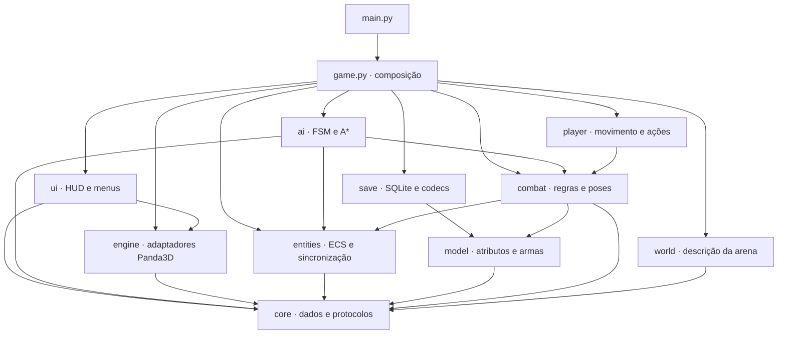

# Arquitetura de A Vigília das Cinzas

A Etapa 2 define dependências que permitem testar as regras de jogo sem criar uma janela. As subentregas 4.1 a 4.5.2 implementam combate, progressão, persistência, IA, chefe, HUD, menus e criação sobre a arena da Etapa 3.

## Dependências

`game.py` é a composição das dependências. `core/`, `model/`, `entities/` e `combat/` usam dados Python. Os adaptadores em `engine/` conhecem Panda3D e Bullet. Os controladores recebem os Protocols de `core/protocols.py`.

O ECS guarda entidades por identificador e mantém índices por conjunto de tipos de componente. Alterações estruturais são feitas fora da iteração de uma query. O componente `Fighter` guarda os timers e recursos de combate, e `Transform` usa vetores puros com Z para cima e yaw medido de +Y em direção a +X.

## Sequência da simulação

Cada quadro coleta eventos de teclado e mouse e um snapshot de gamepad. O acumulador executa passos de 1/60 s, limitando a recuperação de travamentos a 0,25 s por quadro.

1. Retira uma borda da fila de comandos. Cada pressionamento ou soltura é retirado uma vez.
2. Atualiza as intenções do jogador e o golpe periódico do manequim. `AISystem.tick()` escreve `MovementIntent` e `AttackIntent` para os agentes.
3. O combate consome intenções de ataque. Um único `MovementSystem` entrega as velocidades do jogador e dos inimigos às suas cápsulas antes de executar um passo Bullet.
4. O mesmo sistema lê as posições de todos os personagens. As poses de gameplay são avaliadas para esse passo.
5. `HitboxSyncSystem` entrega os pontos dos ossos e os volumes ativos ao adaptador de contato.
6. `CombatSystem` consulta os contatos Bullet, resolve parry, bloqueio e dano e publica eventos.
7. Avança os timers de ações, condições, stagger e regeneração.
8. `DeathSystem` retira corpos mortos do Bullet. Os eventos de morte concedem almas uma vez por vida do inimigo.
9. Atualiza o alvo da câmera. O render interpola posição e yaw do jogador e dos agentes e desenha as armas nos pontos das poses.

Os volumes de contato compartilham o mundo Bullet do cenário. Consultas explícitas entre pares usam as transformações atuais dos volumes e dispensam esperar uma atualização de broadphase. A máscara do cenário exclui as cápsulas das consultas da câmera. O adaptador conserva shapes e nós para reutilizá-los nas próximas janelas ativas.

## Fronteiras e eventos

`tests/test_architecture.py` examina imports absolutos, relativos e de tipagem. O domínio não importa bibliotecas nativas. A UI recebe dados de mundo, inventário e combate pelos Protocols em `core/`. O provedor de mapa está implementado em `world/`, e sua apresentação ficará em `ui/` na 4.5.

Os eventos de dano, parry, stagger e morte são publicados pelo combate. Os handlers em `game.py` atualizam as informações do treino e a progressão. Os eventos de fogueira, área e save definidos em `core/events.py` acionam a persistência. Os eventos de música permitem conectar o áudio na subentrega correspondente.

## Persistência da 4.2

`model/items.py` contém `WeaponSpec`, grades de scaling, requisitos, peso, melhorias e definições numéricas de ataques. Os tipos de pacote e definição de ataque ficam em `model/attacks.py`, acessíveis pelo domínio de armas e pelo combate. As importações públicas anteriores por `combat/attack.py` e `combat/damage.py` continuam disponíveis.

`model/progression.py`, `model/inventory.py` e `model/world_state.py` calculam níveis, almas, carga e flags. O serviço de fogueira publica `BonfireRestedEvent`, `LevelUpRequestedEvent` e `SaveRequestedEvent`. Os handlers em `game.py` executam o descanso, o respawn ou o level up e capturam o snapshot ao terminar o passo de simulação.

`Game.build_snapshot()` reúne os snapshots públicos de movimento, combate e atores com os dados de progressão, inventário e mundo. Os contratos tipados ficam em `model/snapshots.py`. IDs de entidade em ataques são convertidos em chaves estáveis. O carregamento valida dados e referências antes de aplicar qualquer estado vivo.

`SaveService` delega ao `SlotRepository`, que grava jogador, mundo e cabeçalho em uma transação SQLite. O codec de `save/serializers.py` usa os contratos de domínio. A camada de persistência depende de `core/` e `model/`. A matriz existente de `test_architecture.py` cobre todos os módulos adicionados.

## IA e persistência da 4.3

`core/navigation.py` define o `NavGrid` puro. `world/arena.py` o constrói a partir das caixas físicas e `game.py` injeta o grid no `AISystem`. A IA depende dos protocolos de física, do modelo e do ECS. A checagem de arquitetura bloqueia dependências de `ai/` para `world/`, `save/` e `ui/`.

As FSMs operam sobre `AIStateComponent` e `NavAgentComponent`. Os estados escrevem intenções. `Fighter.stagger_steps` e sua interrupção são compartilhados entre jogador, manequins e os três perfis. O parry força stagger inclusive no Bestário. A janela de recuperação dos ataques determina o ritmo dos inimigos.

O Bestário usa uma definição de ataque ranged. O cenário é consultado por `IPhysicsWorld.raycast()`, e `IContactVolumes.raycast()` intersecciona as esferas atualizadas dos ossos. O mesmo resolvedor aplica guarda, parry, i-frames, dano e morte.

A composição mantém um conjunto explícito de atores persistentes. Os inimigos comuns possuem componentes e corpos de runtime e são restaurados às origens ao carregar ou descansar. Seus estados de IA, HP e rotas ficam fora do snapshot. Referências voláteis em ataques do jogador são filtradas. Os manequins persistentes mantêm a compatibilidade dos saves da 4.2.

O descanso preserva o saldo de almas e a mancha do jogador, restaura os adversários e solicita autosave. O snapshot preserva os recursos e ações do jogador durante o carregamento.

## Revisão 4.3.1

O escalonamento de A* mantém uma fase fixa por ID, com `step % REPATH_INTERVAL_STEPS == entity_id % REPATH_INTERVAL_STEPS`. O intervalo mínimo também é respeitado quando a rota termina ou o alvo muda de posição. Isso distribui pedidos que ficaram pendentes durante uma espera longa.

O perfilador opcional de `tools/benchmark.py` mede os estágios do loop e as coletas de lixo. O congelamento do heap existe como opção de experimento desse executável. O runtime principal utiliza o GC normal. O relatório de medições e os picos de apresentação restantes estão no README.

## Sequência aprovada

- 4.1 entrega combate contra manequins, duas armas, recursos e condições de combate.
- 4.2 entrega progressão, inventário, fogueiras e save transacional SQLite, com o snapshot montado na composição do jogo.
- 4.3 entrega três perfis de IA, FSMs, A*, hitscan, troca de alvo e medição com vinte agentes ativos.
- 4.4 entrega o Vigia da Fornalha, duas fases, cinco ataques, fog wall, atalho e provedor de mapa.
- 4.5.1 entrega HUD, pausa real, inventário, equipamento, status e level-up.
- 4.5.2 entrega menu principal, criação, três slots, opções, localização e mapa.
- 4.6 conecta áudio e efeitos, acionados por eventos.

A validação de controle físico e Linux/macOS permanece pendente. Medições com 20 comuns e com chefe mais 15 comuns estão no README.

## Chefe e mundo da 4.4

`model/bosses.py` carrega o perfil puro de `data/bosses/warden.toml`, valida os parâmetros e registra sua arma no catálogo. A composição instala o catálogo antes de ler snapshots. `ai/bosses.py` recebe mundo ECS, perfil, EventBus e RNG injetável. Escreve as mesmas intenções de movimento e ataque dos inimigos comuns. A IA não importa cenário, persistência ou UI.

O bootstrap registra `MapDataProvider` e `BossSystem` na sequência de sistemas de `AISystem`. O corpo de `Game._fixed_step` permanece idêntico à 4.3.1. A verificação do trecho de fonte, extraído por AST e normalizado para LF, está em `artifacts/4.4/verification.json`. `MovementSystem` e a fórmula de dano foram preservados.

`HPChangedEvent` publica o saldo antes e depois do dano. `DeathSystem` observa as alterações de HP por condições entre passos. O chefe filtra seu ID e publica `PhaseTransitionEvent` e solicitações de música. A transição protege contatos e dano periódico por 90 passos. A proteção de dano de status é derivada da introdução, transição e ativação do chefe e reconstruída ao carregar.

`AttackDefinition` em `model/attacks.py`, reexportada por `combat/attack.py`, ganhou `HitboxKind`, raios, bloqueabilidade, fração de dano bloqueado e duração de derrubada. A esfera central usa o mesmo adaptador Bullet, pipeline de dano e conjunto de alvos já atingidos. Formas por osso seguem como padrão. A onda atinge o centro corporal do alvo para manter coerência entre distância, raio e o círculo de aviso.

`FogWall` conhece o protocolo de colisor, flags e eventos de entrada e derrota definidos em `core/`. `Shortcut` persiste abertura e solicita save. `game.py` conecta esses eventos, o deslocamento pela entrada, o chefe, a recompensa e o save. Abrir portas atualiza colisão, apresentação e grid. O grid considera a altura das caixas para permitir travessia sob o lintel.

`MapDataProvider` implementa `IMapDataProvider` sem importar UI. O conjunto `visited_bonfires` existente continua sendo a fonte persistida de fogueiras descobertas. `WorldState.bonfires_discovered` é sua projeção pública. A apresentação do mapa fica para a 4.5.

`BossSnapshot` é aditivo e guarda HP, fase, pose, ação e timers enquanto o chefe está vivo ou aguardando a conclusão da morte. A vitória substitui `fighter` por `None` e persiste a flag. O codec continua dependendo apenas de `core/` e `model/`, com defaults para saves antigos. A transação e o esquema SQLite permanecem os mesmos.

Knockdown compartilha o timer de interrupção e acrescenta a postura no controle e na apresentação do jogador. Essa é a alteração necessária em `player/` para cumprir a escolha de derrubada por 60 passos. Música e reação a Estus possuem eventos observáveis e testados. Reprodução de áudio e a ação de beber ainda precisam dos sistemas correspondentes.

## Apresentação e pausa da 4.5.1

`core/views.py` contém DTOs imutáveis de vida, chefe, condições, atributos, itens e equipamento. `core/protocols.py` define consultas e ações da apresentação. `GameQueries`, no bootstrap, faz a adaptação do domínio. O grafo agora permite a `ui/` importar somente `core/`, `engine/` e seus próprios módulos. O teste de arquitetura proíbe dependências diretas para `model/`, `world/`, `combat/` e `save/`.

`engine/ui.py` concentra DirectGUI, TextNode, carregamento da fonte Noto Sans e adaptação do layout 1280×720 à janela. `ui/text_render.py` define estilos e tamanhos. Widgets e telas são independentes da engine nativa, com backend fake em testes. Barras e labels atualizam o backend somente quando seus valores mudam. O HUD anterior continua acessível apenas pelo argumento de desenvolvimento `legacy_hud`, usado no benchmark A/B.

`InputManager` possui os modos GAMEPLAY e MENU. A abertura de menu é capturada em `Game.frame()` antes do acumulador de física. O roteador recebe as bordas exclusivas do menu. Enquanto MENU, `next_edge()` e `held()` não entregam comandos ao jogador. Trocas de modo limpam filas e suprimem teclas/botões já segurados até a soltura e analógico até o neutro. Há repetição de foco para direcional e analógico.

A pausa é real. `Game.frame()` continua processando menus e desenhando, sem invocar `_fixed_step`. Ao retomar, ele limpa o acumulador e sincroniza as poses anteriores, sem recuperar tempo pausado. O corpo de `_fixed_step`, o sistema de movimento, a física e o cálculo de dano foram preservados. O caminho de pausa anterior permanece para o benchmark com HUD legado.

`MenuRouter` monta pausa, status, inventário/equipamento e level-up. `IUIActions.execute()` valida no domínio e salva alterações durante a pausa. Equipar exige concluir ações em andamento e preserva a definição do ataque atual. Level-up valida fogueira, custo e limite de atributo e mostra previsão sem mutar o domínio. Mapa e Opções são páginas provisórias da próxima etapa.

`tools/verify_ui.py` percorre a apresentação nativa e SQLite temporário. A matriz CI configura testes sem janela nos três sistemas operacionais, mas a execução remota ainda está pendente. Botões e analógicos têm testes simulados. Nenhum gamepad físico foi detectado na validação local.

A comparação de desempenho usa três pares A/B no Pátio com 20 comuns, mesma geometria e grid. O relatório preserva todas as amostras e suas variações. A carga da forja e a carga mista de A* são identificadas separadamente. O README registra o baseline para a 4.6 e a decomposição entre rotas possíveis e impossíveis.

## Estados, slots e opções da 4.5.2

`core/app_state.py` define BOOT, MAIN_MENU, CHARACTER_CREATION, PLAYING, PAUSED, SLOT_SELECT, OPTIONS, CREDITS e QUIT, com um grafo explícito de transições. `StateController` tem enter, exit e tick. Os controladores são injetados pela composição. `game.py` possui uma única assinatura de `AppStateChangedEvent`, responsável por conectar estado lógico, input, cursor, HUD e música. O loop usa a propriedade `simulating` e o tick do controlador corrente.

`ui/front_router.py` escolhe controladores de tela por tabela. Main menu, criação, slots e opções usam apenas protocolos de `core/`. As consultas devolvem DTOs de cabeçalho, origem e opções. A validação da criação mora em `model/characters.py`: cinco origens, dez pontos livres, nome e requisitos da arma. O rascunho permanece na UI e só produz snapshot após confirmação válida.

O esquema SQLite 2 remove o CHECK de slot único através de cópia transacional e preserva os payloads antigos. Antes de migrar, a API de backup SQLite copia o banco consistente, incluindo dados confirmados em WAL. O snapshot continua na versão 1 com campos aditivos de identidade e playtime. Cabeçalho, jogador, mundo e `slot_metadata` têm o mesmo commit. O head-read não chama o codec. Criação usa `require_empty=True` dentro da transação. A composição redireciona todos os eventos de autosave ao slot ativo.

`core/settings.py` valida e grava preferências atomicamente em TOML separado, com compatibilidade JSON. `core/locale.py` carrega os catálogos PT-BR e inglês, com fallback. O backend injeta tradução nas telas e concentra DirectEntry. O foco de texto e a captura de nova tecla suprimem comandos de navegação indevidos. Resolução e sensibilidade são aplicadas pelo adaptador nativo; VSync passa a valer no próximo boot. Volumes são aplicados ao mixer por eventos de configuração.

`MapDataProvider` agora expõe bounds das regiões e posições das fogueiras em DTOs. A UI projeta somente descobertas e atualiza marcadores por mudança dos dados. A matriz CI atual roda testes sem janela e não exige Mesa/Xvfb. A execução remota e o gamepad físico seguem como pendências explícitas da 4.6. Os relatórios de integração e o teste em janela real estão em `artifacts/4.5.2`.

## Áudio e apresentação da 4.6

`core/events.py` concentra `SfxRequestedEvent`, `SoulCollectedEvent` e `LevelUpEvent`. Combate e player reexportam o mesmo tipo SFX; não criam subclasses que quebrariam o dispatch por tipo concreto. `IAudioBackend` está em `core/protocols.py`. O grafo e uma proibição adicional impedem combat/player/world/ai de importar os adaptadores de áudio e partículas.

O bootstrap conecta resultados de combate, ações e progressão aos efeitos. `Fighter.on_attack` e `PlayerController.on_dodge` são callbacks opcionais de observação, configurados em `game.py`; só são chamados após uma ação bem-sucedida. Não participam do snapshot. Nenhum domínio importa pygame, numpy ou Panda3D. `DamageDealt` tem campos aditivos com defaults para tipo predominante e kind do ataque; a fórmula de dano e os timings não mudaram. `_fixed_step` conserva seu hash de referência.

`engine/audio.py` implementa o mixer e `AudioEventRouter` traduz os presets TOML em chamadas ao backend. O mixer é injetável nos testes. A construção preaquece 32 canais SFX e dois canais de loops e carrega os WAVs existentes uma vez. O estado de voz registra prioridade, ordem, posição e ganho. A política de admissão protege canais de maior prioridade e garante entrada de CRITICAL. Um update de apresentação faz atenuação/pan e interpola o ganho dos dois loops. As opções alteram os volumes em execução. Ausência de assets ou falha do dispositivo mantém um backend silencioso; o fechamento é idempotente.

`engine/particles.py` mantém os 500 registros mutáveis do pool e buffers de vértices/índices prealocados. Spawn admite o preset completo ou retorna `False`; não cria recursos nativos. Dois lotes compartilham os vértices, com índices degenerados para o grupo de blend oposto. Os billboards usam os eixos atuais da câmera. Depois da escrita pelos handles, Geom e GeomNode invalidam seus limites para o culling acompanhar os efeitos de outra área. Um teste reproduz a troca Pátio → Forja.

Partículas e `engine/polish.py` atualizam somente na apresentação. Fade e shake não movem corpos nem transforms ECS; o shake só devolve uma nova pose de câmera. A pausa congela esses efeitos e deixa os menus visíveis. Eventos de dano escolhem sangue/faíscas/brasas; almas convergem ao jogador e level-up usa espiral. O chefe emite a nuvem da fase 2 a partir da superfície do corpo.

O benchmark aceita estresse contínuo de 500 partículas, split de render/flip, limite de FPS, captura cProfile de frames lentos e amostragem `nvidia-smi`. O modo split usa a API pública GraphicsEngine, sem alterar o jogo de produção. Seu intervalo de flip inclui conclusão do desenho, não somente a chamada de swap do sistema. Os limites dessa atribuição e os aceites externos ainda pendentes estão no README e em `artifacts/4.6`.

## Conteúdo inicial da 5.1

`model/classes.py` valida os cinco perfis TOML e expõe definições imutáveis de atributos e loadout. `model/characters.py` continua validando nome e dez pontos e cria um Inventory independente. UI recebe nomes, equipamento e magia pelo DTO `CharacterClassView`; não importa modelos nem arquivos TOML. Katana, cajado e maça usam `WeaponSpec`/`Moveset` existentes. O catálogo de conteúdo deve ser carregado antes de decodificar saves que referenciem armas de chefes, como já ocorre no bootstrap.

`model/spells.py` define requisitos, catalisador e `AttackDefinition`. O input CAST entra por `CombatController`, que consulta apenas posse/requisitos e inicia um ataque comum. A mira é injetada por callback da composição, usando lock-on ou direção de câmera. Dano arcano reutiliza o raycast; a cura é resolvida no frame ativo do mesmo CombatSystem. Um marcador em `hit_targets` impede cura repetida. `HealingApplied` e os eventos existentes conectam HUD, áudio e partículas. Não há novo loop ou dependência nativa no domínio.

`PlayerSnapshot.starting_allocation` e `AttackSnapshot.aim/fired` são campos aditivos com defaults. O codec valida os dados antes de restaurar qualquer ator. Persistir mira, disparo e marcador de cura conserva as ações em andamento. Personagens antigos não são recalculados a partir do novo perfil; mantêm o estado salvo. Trocar de slot ou criar outro personagem limpa partículas e o fade/shake da sessão anterior.

Gamepad físico passa ao backlog pós-1.0. A cauda de apresentação passa à 5.6 com exigência de relatório, sem exigir atribuição conclusiva. O CI permanece matriz GitHub Actions, executando testes sem janela; a ativação remota aguarda o repositório. Essas decisões substituem o antigo bloqueio de fechamento da Etapa 4 e não alteram o grafo de imports.

## Persistência da 5.2a

O esquema SQLite atual é 3; snapshot e timings permanecem na versão 1. `save/migrations/` contém as passagens reais 1→2 e 2→3. O primeiro passo conserva os payloads ao remover a restrição de slot único; o segundo acrescenta classe e criação em `slot_metadata`. O dispatcher coordena backup, lock, migrações, checagem de referências e atualização da versão. A releitura de versão sob `BEGIN IMMEDIATE` protege a abertura concorrente. O backup usa outra conexão de leitura, pois a cópia da própria conexão com transação de escrita aberta poderia ficar bloqueada.

`SlotRepository.create` reutiliza a gravação transacional com `require_empty=True`. `delete` remove mundo, jogador, cabeçalho e raiz na mesma transação. Os métodos existentes continuam compatíveis. O serviço acrescenta `list_slots`, que projeta os três destinos sem consultar os payloads, e `SlotView` acrescenta `class_id`, `created_at` e o alias `updated_at` para a data já existente de save. Não há import de save pela UI. A composição já usa a criação protegida e as consultas novas; a confirmação de exclusão e a renderização final do cabeçalho foram concluídas na 5.2b.

Nos dados antigos, a criação é estimada pelo primeiro timestamp disponível. Nas novas criações, o cabeçalho recebe timestamps UTC e preserva a data de criação nos updates. Os testes congelam os schemas antigos, mantêm JSON byte a byte e injetam falhas após DDL e DML. A integração nativa disponibiliza bancos sintéticos antes/depois para inspeção em `artifacts/5.2a`.

## Contratos e segurança de slots da 5.2b

`SettingsChangedEvent(UserOptions, changed)` pertence a core. `OptionsUI` só envia SET_OPTION, REBIND ou RESET_OPTIONS por `IMenuActions`; a composição grava `SettingsStore` e publica o evento. `AudioEventRouter` aplica os três ganhos imediatamente. O consumidor da composição injeta `engine/config.ConfigAdapter`, render, input, polish e HUD; nenhuma tela acessa arquivos ou mixer. O adaptador detecta resoluções disponíveis e aplica tamanho/fullscreen. Sombras de contato e névoa vivem no render; acessibilidade só altera apresentação. VSync é persistido para o próximo boot.

`data/config.toml` define padrões. `data/settings.toml` armazena só preferências divergentes, sem identificação de hardware. O JSON anterior pode ser importado, preservando o original. Gravação usa arquivo temporário, flush/fsync e replace. Reset por seção conserva as outras opções, e reset global usa confirmação. Remapeamento detecta conflitos por dispositivo; substituição confirmada desatribui o vínculo anterior. Todos os destinos de gameplay podem ser atribuídos ao gamepad, inclusive os inicialmente vazios. Reset remove esses vínculos adicionais do input ativo.

`SlotDeletionView` fornece identidade revisada e aviso de bloodstain. `SlotSelect` apresenta dois `Dialog`s sucessivos, com Cancelar sob foco e confirmação final vermelha. DELETE_SLOT carrega slot e timestamp revisado. A consulta de uso desabilita a confirmação e o serviço verifica novamente sob lock. `MenuRouter.navigate` é compartilhado pelas telas frontais e de pausa. O backend concentra sliders, foco e fade de 150 ms.

`save/locks.py` implementa leases de arquivo por caminho canônico e slot: byte lock não bloqueante em Windows, flock em POSIX. A sessão de jogo adquire antes de carregar/aplicar o snapshot e mantém até voltar ao menu ou fechar. Escritas avulsas também cooperam; exclusão tenta o lease sem espera e usa transação de SQLite com espera configurada em 25 ms para não bloquear o menu durante outro escritor. Alteração de timestamp invalida a confirmação. Não se remove o arquivo do lease: o SO libera o descritor, e remover o inode introduziria corrida. Ferramentas externas que ignoram o protocolo não estão cobertas pelo lease cooperativo.

O backup de migração é publicado por replace somente após concluir a API de backup. A migração e as duas versões pertencem ao mesmo commit. `tests/migration_crash_worker.py` instrumenta conexões apenas no subprocesso de QA, sem hooks de falha no código de produção. São 48 encerramentos reais, cobrindo DDL/DML, páginas do backup e fronteiras de commit. Reabertura verifica WAL, integridade, referências e payloads antes de chamar novamente o migrador. Fixtures são sintéticas de schemas históricos, sem corpus de jogadores localizado no workspace.

Os novos campos de `VitalsView` expõem ícone/tipo, custo, recuperação e prontidão da magia; o HUD não conhece `Fighter`, catálogo de spells ou controlador. Escala e contraste usam o backend de UI. O hash de `_fixed_step` permanece `568bf0d69b8a81782c627a4fd0c61086c4a817e0c49c03f5dbf809388f5af6bb`.

## Regiões e encontro da 5.3

`model/areas.py` define bounds e identidade geográfica sem engine; o save consulta esse domínio para seus cabeçalhos. `world/area.py` lê definições TOML em DTOs de caixas, spawns e passagens. O mesmo catálogo de caixas gera a apresentação, corpos estáticos e grid inflado para a cápsula. As definições das duas regiões novas são validadas no boot e mantidas na composição.

`Game.change_area` captura `AreaSnapshot`, fecha as inscrições do chefe/fog anteriores e remove corpos, entidades, volumes e nós da cena. O jogador permanece no mesmo ECS e mundo físico. A região de destino é montada, seus atores restaurados e a sincronização de poses/volumes concluída antes de retomar a simulação. A entrada publica descoberta, música e autosave. O fade é apresentação; a sequência de `_fixed_step` permanece intacta. O cache dormente guarda somente snapshots, não objetos de engine.

`WorldSnapshot` acrescenta `area_id` e `dormant_areas` com defaults. O codec converte estruturas aninhadas, verifica unicidade global dos IDs e valida referências de combate por região. A morte de comuns carregados é restaurada, sem pagar novamente a recompensa. Reset de navegação pode conservar os recursos/posições carregados; descanso restaura os comuns e descarta os estados transitórios das regiões. As flags de chefe derrotado/atalho e a bloodstain são globais. O preflight de um load verifica o catálogo de atores e fogueiras antes da troca da cena.

`BossProfile` agora informa bounds, prefixo musical e item único. A FSM compartilhada usa os papéis dos cinco movimentos, com definições próprias para a Abadessa. A terceira ação pode ser ranged, com mira explícita no jogador. Transições e morte usam os eventos existentes. `BossSystem.close` e `FogWall.close` removem handlers ao descarregar. O EventBus acrescentou unsubscribe; não há assinaturas acumuladas a cada visita.

`ArenaRenderer` combina caixas estáticas por cor/material em buffers de vértices/normais. As caixas de colisão continuam individuais e derivadas dos mesmos dados. Portas móveis, atores, armas e HUD mantêm seus nós próprios. Cores de neblina/luz são uniforms do programa GLSL compartilhado. A UI do mapa ajusta a projeção aos bounds recebidos via `IMapDataProvider`, e a UI de gameplay recebe nomes de magia e item em campos separados do DTO.

O benchmark registra minimização. O estágio historicamente chamado render_and_swap engloba `ShowBase.__igLoop`, incluindo seu sleep quando minimizado; não equivale a um timer de GPU. PStats oferece a separação de coletores. Capturas cProfile por frame são retidas em memória e gravadas após a amostra, evitando que dump_stats contamine o próximo intervalo. Os resultados e o código 5.2b arquivado estão em `artifacts/5.3/diagnostics`. Há causa confirmada para os picos de 100 ms e uma cauda rara de combate ainda sem causa confirmada. Não houve alteração de GC em produção.

Os agentes do Pátio passam a usar `patio.enemy.N` nos snapshots. O preflight aceita tanto o catálogo legado só com manequins quanto o catálogo novo com agentes contíguos. Um load legado inicializa agentes ausentes; um load novo restaura contagem, recursos e mortes sem pagar novamente loot. A composição mantém compatibilidade com o parâmetro de carga de zero a vinte agentes. O codec registra catálogos de chefes sob demanda, permitindo reabrir saves em processo limpo sem importar Panda3D/pygame/numpy.

## Diagnóstico e gravação antes do QA da 5.4

O log próprio usa QueueHandler/QueueListener em core/log.py. O produtor só formata/enfileira; a escrita do destino ocorre numa thread dedicada, drenada após a simulação. Handlers externos são preservados. O teste de concorrência mantém o destino bloqueado e comprova que o produtor termina antes de liberá-lo.

SaveRequestedEvent durante combate só marca o slot. Pedidos coalescem; o snapshot é construído no limite seguro, depois de morte e timers. Fogueira, mudança de área, respawn, menu pausado, retorno ao menu e saída permitem commit síncrono; pedidos comuns/F8 não autorizam I/O no combate. Um load cancela pedidos e permissões anteriores. Falha mantém o estado pendente, mas não provoca nova tentativa a cada passo. O contrato transacional SQLite e a sequência de _fixed_step permanecem iguais.

tools/frame_recorder.py mantém até 31 frames com perfis cProfile, tempos de estágios/CPU, GC e contagem de manifolds/pontos Bullet. Corpo ou intervalo acima de 200 ms aciona retenção, limitada às oito piores capturas com prioridade para não minimizadas. Merge e escrita ocorrem após a medição. O binário .pstats usa o formato CPython, explicitamente distinto do formato Panda PStats; o cliente Panda 1.10.16 instalado não exporta arquivos. O modo sem pico grava worst_, sem fingir uma ocorrência. Ensaios de minimização/injeções de teste têm identificação própria.

Em 24/11/2026 o usuário retirou o bloqueio geral. O gate agora é por build: QA com diagnóstico ativo; pico acima de 200 ms põe a build em quarentena até triagem. A causa histórica continua não confirmada. artifacts/5.3/verification.json conserva o histórico e artifacts/5.4/verification.json registra a nova política.

## Campanha da 5.4

As duas novas regiões seguem Area/AreaSnapshot e os catálogos de navegação existentes. BossProfile acrescenta phase3_threshold opcional; BossSnapshot acrescenta hazard_step com default zero. O Custódio usa três fases; chefes antigos continuam com duas. BossSystem agenda pulsos e CombatSystem os resolve após o input do jogador, respeitando resistência e invulnerabilidade do passo corrente. Apresentação lê o relógio de gameplay e reutiliza o círculo de aviso; o render não causa dano.

WorldSnapshot e WorldState acrescentam ending/credits_seen com defaults. O esquema SQLite continua 3. O codec verifica os estados de final, vitória e fases, registrando sob demanda o catálogo do Custódio sem importar bibliotecas nativas. model/endings.py valida a escolha imutável. A composição valida altar e pausa, grava antes dos créditos e reverte o estado em memória se a gravação falhar. Credits mostra erro de persistência sem despachar duas ações de retorno. UI continua sem imports de world.

core/flight_recorder.py é puro e recebe uma função de amostragem dos contatos. O shim em tools preserva o benchmark arquivado. engine/diagnostics.py observa tasks de gameplay/render, correlaciona GC e usa callback de captura com escrita em thread dedicada. A retenção em memória é limitada; todos os gatilhos de QA são encaminhados ao escritor, com erros/backlog explícitos. O registro de quarentena é persistente e identificado pelo hash do código/dados/assets/dependências. Fonte e versões são arquivadas antes da observação. O main liga o serviço, e --no-diagnostics evita sua construção; logging assíncrono e política de save continuam ativos.

Os PNGs de evidência são capturados em memória durante o percurso e codificados após fechar a medição. Isso evita que I/O de screenshots do próprio teste seja confundido com trabalho de Game.frame. Picos anteriores desse caminho foram mantidos e triados com seus binários. A música ao retomar usa o prefixo do chefe/ambiente da região; o relógio fixo e a ordem de _fixed_step continuam preservados.
