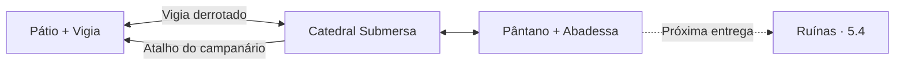

# A Vigília das Cinzas

Jogo 3D em Python com Panda3D e Bullet: cinco áreas, cinco classes, três chefes, três desfechos e persistência por personagem. Inclui combate, magia, progressão, menus, mapa, áudio e recursos procedurais. A **5.4 foi aceita funcionalmente**; a **5.5 trata do fechamento de release**, sem adicionar conteúdo. A versão 1.0 tem como alvo teclado e mouse. O estado das verificações e os bloqueios restantes estão em [RELEASE_STATUS.md](RELEASE_STATUS.md). A campanha está no [GDD](GDD.md) e os contratos na [arquitetura](ARCHITECTURE.md).

O pacote seguinte acrescenta a matriz pré-chefe dos três finais e as **etapas 1 a 3
experimentais de Movimento Ágil: Dash, Slide, Wall jump, Slam, momentum e tolerâncias do salto**, por solicitação do usuário.
O modo vem OFF e é salvo por personagem. Não altera HP/dano dos chefes.

## Executar

Requer Python 3.11 ou superior e uma sessão gráfica com OpenGL. No PowerShell, abra a pasta do projeto e rode:

```powershell
python -m venv .venv
.\.venv\Scripts\python.exe -m pip install -r requirements.txt
.\.venv\Scripts\python.exe main.py
```

No Linux e macOS, use `.venv/bin/python` nos dois últimos comandos.

| Ação | Teclado e mouse |
| --- | --- |
| Mover | WASD |
| Girar a câmera | Mouse |
| Correr | Shift + movimento |
| Rolar ou recuar | Espaço com ou sem movimento |
| Travar ou destravar alvo | Q |
| Trocar alvo travado | Z e X, ou movimento lateral do mouse |
| Ataque leve ou crítico contextual | Clique esquerdo |
| Ataque forte carregado | Segurar e soltar clique direito |
| Bloquear | Ctrl |
| Parry | R |
| Conjurar a magia inicial, com o catalisador equipado | E |
| Trocar entre armas possuídas e com requisitos atendidos | 1 |
| Voltar ao checkpoint e restaurar os manequins | F5 |
| Descansar, recuperar almas, abrir atalho ou entrar na névoa | F |
| Recarregar o perfil do chefe e reiniciar o encontro | F7 |
| Solicitar save e carregar o slot ativo | F8 e F9 |
| Viajar entre fogueiras ativadas | F6 junto à fogueira |
| Melhorar a arma equipada | U junto à fogueira |
| Pausar ou retomar | Esc |
| Abrir inventário / status / level-up | I / C / L |
| Navegar no menu | Setas ou WASD |
| Confirmar / voltar | E, Enter ou Espaço / Esc |
| Excluir o slot sob foco | Delete |
| Categorias do inventário | Tab / Shift+Tab, ou botões < e > |
| Sair | F10 na pausa ou fechar a janela |

Q escolhe o alvo visível mais alinhado em um cone total de 60°, com distância como desempate. Ao esvaziar o cone, o candidato visível mais próximo ganha prioridade. Z/X percorrem o manequim central e os três inimigos. Os dois manequins passivos permanecem disponíveis para treino de ataques.

## Movimento Ágil (experimental, OFF por padrão)

Ative em **Opções → Controles → Movimento Ágil** para o personagem atual.
Alt dá dash; Shift + movimento + V inicia slide; B pula e pode cancelar o
slide. Todas as ações aceitam remapeamento. O dash tem duas cargas, recarga
de 1,2 s por carga, seis passos de i-frames e não gasta stamina. Slide custa
stamina e mantém vulnerabilidade; clique esquerdo usa seu ataque próprio.
No ar, direcional contra uma parede inicia cling por até 0,4 s; B salta
para longe. A mesma parede só fica disponível novamente após tocar o chão.
**G no ar dá Slam**, com área de 2,5 m e recuperação vulnerável de oito passos.
O modo guarda cargas/timers e volta a OFF ao carregar um save OFF.

O perfil experimental de gamepad usa direcional direito/baixo/cima para
dash/slide/pulo e direcional esquerdo para Slam, remapeáveis; nos menus,
o direcional continua navegando.
Isso tem testes simulados, **sem validação de controle físico**. A 1.0
continua tendo teclado e mouse como alvo. Momentum decai em 24 passos;
coyote e buffer de salto aceitam seis passos. Cling zera o impulso, e roll
usa seu próprio movimento. Ver [design e limites](docs/movement_ultrakill.md).

## Verificações do pacote de fechamento

`tests/test_endings.py` carrega três bancos pré-chefe versionados. Os dois
primeiros chefes estão derrotados; o terceiro está vivo, com 5600 HP, e o
personagem está fora da névoa. A escolha é feita no altar após a vitória.
Decisão ausente ainda é válida antes do altar; decisão inválida/dupla é
rejeitada sem sobrescrever o save. Epílogos PT/EN têm assert de não-colisão.

`tools/verify_endings.py` repetiu os três fluxos com Bullet e UI nativos,
incluindo recarregar créditos ainda não reconhecidos e o pós-créditos em
processo limpo. O golpe final usa HP=1 e teleporte declarado: verifica o
fluxo, sem certificar balanceamento. `tools/verify_agile.py` cobre lock-on,
save no meio do dash, cápsula, salto de slide e troca ON/OFF por personagem.

`tools/verify_vertical_movement.py` testa cling, wall jump, Slam, lock-on e
save/reload com Bullet e gravador ativo. `test_slam.py` cobre o evento de
impacto sem atacante e múltiplos alvos, sem depender de janela.
`tools/verify_momentum.py` testa a herança de velocidade, o cancelamento por
roll e o coyote no sexto passo após save/load. Ataques de dash/slide são
entradas próprias no moveset; a fórmula de dano permanece intacta.

O [template de playthrough](data/balance_templates/playthrough.md) está
versionado. Os registros locais em `artifacts/balance/` estão marcados como
não jogados. A comparação OFF agora usa [frame time em ms, 60 s e cap de 60 Hz](docs/qa/frame-time-limited-2026-11-25.json).
O [experimento anterior em FPS](docs/qa/agile-off-performance.json) permanece
preservado como histórico, com suas limitações. A etapa 3 também mede
[capped e uncapped com o chefe final na fase 3](docs/qa/stage3-frame-time-2026-11-25.json).

Edite `data/config.toml` para trocar teclas, botões, resolução, VSync e sensibilidade. A seção `[bindings]` aceita combinações como `roll = "shift-r"`. A opção `--config caminho.toml` permite carregar outro perfil ao iniciar. Use `--enemies 20` para executar a arena com vinte agentes.

## Testar

```powershell
.\.venv\Scripts\python.exe -m pytest -q
```

Os testes exercitam o grafo de imports, comandos sob recuperação de quadros, remapeamento, colisão da cápsula, câmera, combate, progressão, inventário, flags e persistência. `test_parry.py`, `test_hitbox_sync.py` e `test_save.py` usam adaptadores simulados. O teste de save fecha e reabre conexões SQLite, restaura os controladores por APIs públicas e verifica ataque ou rolamento em andamento, condições, referências de alvos, inventário e flags. Uma falha SQL simulada depois da escrita do jogador comprova rollback conjunto com o mundo, e gravações concorrentes verificam a consistência do slot.

`test_fsm.py`, `test_pathfinding.py` e `test_ai_system.py` verificam transições em passos, contorno de pilares, proteção de quinas, combos, hitscan e parry dos três perfis com física simulada. A arquitetura impede imports de `world/`, `save/` e `ui/` pela IA.

## Treinar combate

O manequim central desfere um golpe lento ao detectar o jogador na sua frente e a até 2,3 m. Ele brilha durante a preparação. Os outros dois manequins permitem testar golpes e críticos. Use Q para manter a câmera no alvo e aproxime-se até a arma alcançá-lo.

- Clique novamente durante um golpe leve para enfileirar o próximo golpe do combo. A espada tem três golpes e o machado tem dois.
- Segure o ataque forte para ampliar o dano e solte para iniciar a preparação. A carga máxima é liberada automaticamente após 36 passos.
- Mantenha Ctrl e encare o golpe para bloquear. A guarda reduz dano e consome estamina, podendo ser quebrada.
- Use R quando o bastão estiver prestes a alcançar o escudo. Um parry bem-sucedido expõe o manequim por 90 passos. Após recuperar a postura, aproxime-se e use ataque leve para riposte.
- Dê a volta no manequim parado. Um ataque leve a até 1,65 m dentro do cone traseiro inicia backstab.
- Espaço com movimento rola com i-frames nos passos 2 até 13. Sem movimento, executa um recuo. Ações, corrida e defesa consomem estamina, que regenera após um atraso.
- F5 retorna ao checkpoint e restaura recursos e adversários. O saldo de almas, nível, inventário, melhorias e mancha da última morte persistem.

Vida do jogador, estamina, arma, estado e HP de cada manequim aparecem na tela. O log registra os eventos de dano, parry, stagger e morte.

## Números de combate da 4.1

Os intervalos usam índice inicial zero e final exclusivo. Cada golpe tem preparação, atividade e recuperação. A janela de parry cobre os passos 0 a 11. Um contato no passo 12 recebe guarda residual, e um contato no passo 13 recebe dano normal. I-frames do rolamento cobrem 2 ≤ passo < 14.

O dano de cada canal é calculado por `base × (1 + 0,025 × scaling + 0,09 × upgrade) × 100 / (100 + resistência efetiva)`. O scaling físico soma Força e Destreza com os coeficientes da arma. Fogo e magia usam Inteligência e sagrado usa Fé. A resistência efetiva soma a resistência do canal a `0,6 × Endurance`, com piso em −50. Riposte multiplica o resultado por 2,35, e backstab por 1,85. Um bloqueio frontal absorve 78% do dano e custa `0,65 × poise do golpe + 0,25 × dano` em estamina. Guarda insuficiente sofre quebra e dano integral.

| Arma e golpe | Preparação / atividade / recuperação | Estamina | Dano base / poise |
| --- | --- | --- | --- |
| Espada, leve I | 11 / 7 / 17 | 15 | 25 / 16 |
| Espada, leve II | 9 / 7 / 18 | 16 | 28 / 18 |
| Espada, leve III | 14 / 8 / 24 | 20 | 37 / 25 |
| Espada, forte | 17 / 9 / 25 | 30 | 45 / 39 |
| Machado, leve I | 15 / 8 / 22 | 21 | 36 / 27 |
| Machado, leve II | 16 / 9 / 26 | 24 | 43 / 33 |
| Machado, forte | 21 / 10 / 29 | 34 | 59 / 50 |

A carga forte amplia o dano em até 65%. O golpe forte do machado acumula sangramento. O sistema também resolve veneno, congelamento e maldição, cobertos pelos testes de condições. Dano, requisitos, scaling, peso, níveis de melhoria e definições de ataques ficam em `model/items.py`. `player/movesets.py` seleciona essas definições.

O jogador e o bastão do manequim usam a mesma `resolve_damage()`. A fórmula numérica da 4.1 foi preservada na 4.2, inclusive os canais de Inteligência e Fé. Dano, críticos e recompensa de almas são determinísticos. Sorte modifica a recompensa por um multiplicador fixo.

## Inimigos da 4.3

Os inimigos usam `AttackDefinition` e `resolve_damage()`. A pausa entre ataques é controlada pelo recovery do moveset. Cada agente possui uma cápsula Bullet, uma FSM e volumes por osso. Dano e parry interrompem o mesmo componente `Fighter` usado pelo jogador.

| Inimigo | HP / poise | Padrão | Preparação / atividade / recuperação | Dano base / poise do golpe |
| --- | --- | --- | --- | --- |
| Cinzeiro | 164 / 70 | Aproximação lenta e um corte amplo | 34 / 8 / 30 | 29 / 36 |
| Rancor | 110 / 20 | Aproximação rápida, dois cortes | 10 / 6 / 8 e 8 / 7 / 24 | 14 / 12 e 19 / 18 |
| Bestário | 122 / 40 | Recua a curta distância, mira e dispara | 38 / 1 / 72 | 24 perfurante / 16 |

O Bestário fixa a mira durante a preparação. O disparo consulta o cenário por raycast e as esferas atuais dos ossos, respeita obstáculos, bloqueio e i-frames e pode ser aparado. Uma linha breve mostra o trajeto do tiro.

As FSMs percorrem Idle, Patrol, Chase, Reposition, AttackWindup, Recover, Staggered e Dead. Há no máximo uma transição por passo. A patrulha começa após 90 passos de espera, e a janela mínima entre recálculos de A* é de 15 passos. Rotas são reutilizadas até o objetivo mover mais de 1 m ou a rota terminar. Os agentes distribuem os pedidos por ID. O grid deriva das caixas da arena com margem para a cápsula, e a suavização preserva as quinas bloqueadas.

## Vigia da Fornalha · 4.4

Siga para o norte do Pátio. F abre a porta do claustro e, junto à névoa, entra na forja. O atalho permanece aberto após descanso e load. A névoa bloqueia a saída durante o encontro e desaparece após a vitória. O grid acompanha os dois colisores e permite passar sob o lintel do portão.

O Vigia tem 3200 HP e 180 de poise. A introdução dura 180 passos. Ao ficar **abaixo** de 1600 HP, ele interrompe a ação e fica invulnerável por 90 passos, inclusive a veneno já aplicado. A fase 2 acrescenta agarrão e onda de fogo. A escolha de ataques usa RNG injetável. Dano e recompensa permanecem determinísticos.

| Ataque | Preparação / atividade / recuperação | Alcance | Dano base / poise |
| --- | --- | --- | --- |
| Golpe vertical | 54 / 12 / 54 | 3,2 m, 90° | 42 impacto / 60 |
| Varredura | 30 / 9 / 36 | 4 m, 180° | 28 corte / 30 |
| Punição reativa | 12 / 6 / 18 | 2,8 m | 22 perfurante / 45 |
| Agarrão | 42 / 6 / 78 | 2,5 m | 95 impacto, derrubada de 60 passos |
| Onda de fogo | 60 / 30 / 120 | Esfera de 2 a 6 m | 35 fogo / 20, uma vez por execução |

A punição reage ao fim de combos de dois ou mais golpes, com cooldown de 180 passos. Na fase 2, guardar por 15 passos a até 3 m habilita o agarrão, com cooldown de 240. Ele ignora guarda, parry e poise. Ficar a menos de 2 m por 30 passos habilita a onda, com cooldown de 300. O círculo visível sinaliza a preparação. Corra para fora de 6 m antes da atividade. A guarda frontal reduz o dano da onda em 50%, com estamina suficiente.

Os 30 passos ativos usam índices de 0 a 29. A esfera atinge 2 m no primeiro e 6 m no último passo ativo. As armas continuam usando esferas por osso. Stagger ou parry na fase 2 abre até quatro ripostes durante 240 passos. Os críticos não renovam a janela. O Vigia é imune a backstab.

Na fase 1, vertical e varredura têm pesos 60/40. Depois do vertical há 60% de chance de reposicionar por 120 passos. Depois da varredura há 70% de chance de atacar imediatamente. Na fase 2 essa chance é 85% para ataques comuns. Agarrão e onda mantêm cooldowns próprios. Os ataques têm custo zero de estamina, com ritmo controlado pela recuperação.

Barra, nome, indicação de fase e fade são a apresentação provisória. A vitória aguarda 240 passos de simulação após HP zerar, abre a névoa e solicita autosave. A recompensa base escolhida é 2400 almas, ou 2640 com Sorte 10. O chefe derrotado permanece morto após descanso e load. Descansar com ele vivo restaura HP e fase 1, preservando almas e mancha do jogador.

Os números ficam em `data/bosses/warden.toml`. F7 valida e aplica o perfil sem reiniciar o aplicativo, restaurando o encontro e repetindo a introdução se ele estava ativo. IDs de chefe e arena permanecem estáveis. Para testar novamente um chefe derrotado, use outro arquivo de save.

`MapDataProvider` fornece áreas, fogueiras descobertas e posição para a UI da 4.5. `bonfires_discovered` deriva de `visited_bonfires`, mantendo uma fonte persistida. As solicitações de música ficam observáveis no log, com reprodução prevista para a 4.6. A reação a Estus está ligada a `ItemUseStartedEvent` com `item_id="estus"` e testada em domínio. A ação de beber será conectada ao sistema de consumíveis.

Campos opcionais do save preservam fase, HP, posição, ação e timers do chefe vivo. Após a vitória, seu `fighter` é `null` e a flag de derrota é persistida. Na entrega 4.4, o esquema SQLite permaneceu na versão 1. A 4.5.2 migra o banco para a versão 2, conforme a seção de persistência. Saves anteriores recebem defaults. `_fixed_step`, `MovementSystem` e `combat/damage.py` foram preservados. Knockdown exigiu duas adições pequenas em `player/`, previstas pela escolha do agarrão com derrubada.

## Progressão e fogueiras

O jogador começa no nível 1 com Vigor 10, HP máximo `80 + 6 × Vigor`, estamina máxima `70 + 4 × Endurance` e capacidade de equipamento `24 + 2 × Endurance`. Poise máximo é `20 + 2 × Endurance`. A escala de Força, Destreza, Inteligência e Fé é a da fórmula de combate. A recompensa de almas usa `1 + 0,01 × min(Sorte, 99)`.

Um manequim concede 80 almas base, modificadas por Sorte. Com os atributos iniciais, são 88 almas. O próximo nível custa `60 + 25 × nível + (3 + faixa) × nível²`, com `faixa = (nível − 1) // 20`. O atributo escolhido cresce um ponto até o limite de 99.

A fogueira sul fica no ponto inicial. A fogueira norte fica diante do portão. Aproxime-se e pressione F para ativar e descansar. O descanso preserva as almas carregadas e a mancha do jogador, restaura recursos e condições, respawna manequins e inimigos e solicita autosave. Após ativar ambas, F6 alterna entre elas e também executa o descanso. As recompensas atuais dos inimigos são creditadas diretamente no saldo.

Junto a uma fogueira ativada, os atalhos abaixo exercitam o hook de level up.

| Tecla | Atributo |
| --- | --- |
| 2 | Vigor |
| 3 | Endurance |
| 4 | Força |
| 5 | Destreza |
| 6 | Inteligência |
| 7 | Fé |
| 8 | Sorte |

U melhora a arma equipada até +3, consumindo fragmentos e almas. Para a melhoria seguinte, o custo é `nível atual + 1` fragmentos e `80 × (nível atual + 1)²` almas. O inventário inicial contém três fragmentos. A validação dos custos precede o consumo de ambos.

A carga equipada considera arma, armadura e escudo. Abaixo de 30% da capacidade o rolamento é leve, de 30% até menos de 70% é médio, e a partir de 70% é pesado. A duração e a velocidade variam por categoria. O peso total do inventário é contabilizado separadamente.

Morrer deixa as almas carregadas no local e provoca respawn no último checkpoint após dois segundos. A mancha aparece em azul e pode ser recuperada com F a até 1,8 m. Uma nova morte substitui a mancha anterior. Uma morte com zero almas elimina a mancha anterior.

## Save dos três slots

O jogo abre no menu principal. Continuar lista os três slots e carrega o escolhido. F8 solicita save e F9 recarrega o último estado gravado do slot ativo. Durante gameplay, F8, mortes, loot e recuperação de almas deixam uma solicitação pendente. O estado mais recente é gravado na próxima fogueira, transição/respawn com fade, menu pausado, retorno ao menu principal ou saída. Equipamento e level up nos menus são gravados com a simulação pausada. Solicitações repetidas resultam em uma gravação transacional no slot ativo. Uma falha mantém o progresso pendente para o próximo limite seguro; não tenta gravar a cada passo de combate.

O arquivo padrão continua em `saves/slot1.sqlite3` para preservar o caminho anterior, agora com os slots 1, 2 e 3 no mesmo banco. Use `--save-file caminho.sqlite3` para selecionar outro banco. Novo Jogo usa um slot vazio e valida a ocupação novamente dentro da transação. Nenhum slot ocupado é sobrescrito pela criação. A composição do snapshot continua em `Game.build_snapshot()`, com os contratos públicos dos controladores.

Posição, atributos, recursos, ações em andamento, timers, condições, nível, almas, mancha, inventário, arma equipada e melhorias entram no snapshot. Os manequins de treino mantêm os IDs e o estado persistente da 4.2. As referências a manequins já atingidos são restauradas para impedir acertos duplicados. As flags incluem checkpoints, chefes, atalhos e itens coletados.

Os inimigos comuns da 4.3 retornam vivos às posições iniciais ao carregar. FSM, rotas e ações desses agentes são recriados. Referências a esses alvos voláteis nos ataques do jogador são descartadas ao montar o snapshot. Os recursos e os timers do jogador são restaurados. Os arquivos da 4.2 continuam aceitos, com valores padrão para os campos opcionais novos.

SQLite grava cabeçalho, jogador, mundo e metadados dentro de uma transação com WAL e `synchronous=NORMAL`. O esquema atual é a versão 2. A migração da versão 1 cria backup via API SQLite, substitui a restrição de slot único por slots 1–3 e copia os JSONs sem reescrevê-los. O snapshot e os timings continuam na versão 1, com defaults para nome, origem e tempo em saves antigos. Os saves são validados antes de alterar os atores. As condições e timers estão em `core/timing.py`.

## Referência de desempenho da 4.3

Medição da 4.3 no Windows, Python 3.13 e Panda3D 1.10.16, com NVIDIA GeForce GTX 1660 Ti, janela de 1280×720 e VSync desligado. A cena contém vinte inimigos vivos, com cápsulas, FSMs e combate ativos, além do jogador e dos três manequins. O ensaio mantém o jogador parado com vida elevada para sustentar os ataques durante toda a amostra.

| Métrica | Resultado |
| --- | --- |
| Janela de medição após aquecimento de 2 s | 10,004 s |
| Quadros medidos | 1836 |
| FPS médio | 183,53 |
| 1% low | 56,45 FPS |
| Tempo de quadro no percentil 95 | 11,819 ms |
| Média de AISystem.tick por passo | 0,2912 ms |
| Passos de IA medidos | 601 |
| Consultas A* durante a amostra | 39 |
| Média de A* durante o combate | 0,0600 ms |
| Média de A* isolado, em 200 rotas | 0,5621 ms |

O 1% low é o inverso da média de duração do 1% de quadros mais lentos. O ensaio isolado de A* usa rotas variadas fora do loop de renderização. No encerramento da amostra, os vinte agentes estavam em ataque, recuperação ou reposicionamento.

Para reproduzir, execute `.venv/Scripts/python.exe tools/benchmark.py --seconds 10 --enemies 20`. O benchmark usa um banco temporário e desliga VSync por padrão. `--vsync` permite repetir com sincronização. A leitura histórica da 4.2 foi de 59,99 FPS com VSync e registra o teto daquele ensaio.

## Revisão 4.3.1

O teste de regressão da fogueira começa com 500 almas e uma mancha de sangue. Ele executa o handler real de descanso e de respawn com física simulada, verifica o saldo observado pelo evento de autosave e repete o caminho de teleporte e retorno ao checkpoint. A verificação na arena também percorreu descanso, teleporte, autosave SQLite e load, preservando saldo, mancha e flags.

O agendamento do A* foi corrigido para atender um agente apenas quando `step % 15 == entity_id % 15`, além do intervalo mínimo entre pedidos. Antes da correção, o teste com alvo movendo após tempo parado reproduziu 20 consultas no mesmo passo. O teste agora distribui as vinte consultas pelos quinze passos seguintes, com no máximo duas por passo nesse grupo de agentes.

O benchmark aceita `--profile` para registrar GC, Bullet, poses, sincronização de volumes, combate, apresentação e renderização/swap. Ele também informa quantos pedidos de rota ocorreram no passo mais carregado e quantas gravações de save aconteceram durante a amostra.

Foram comparadas coletas normais e `--freeze-gc` após o aquecimento. O congelamento transfere os objetos rastreados existentes para a geração permanente. O processo de benchmark desfaz esse estado ao encerrar. O jogo utiliza coleta normal. [Documentação do GC do Python](https://docs.python.org/3.13/library/gc.html#gc.freeze)

| Ensaio instrumentado de 10 s, com vinte inimigos e VSync desligado | FPS médio | 1% low | Maior coleta GC |
| --- | --- | --- | --- |
| Coleta normal, antes do ajuste de agendamento | 154,42 | 61,48 | 0,0791 ms |
| Heap congelado, antes do ajuste de agendamento | 152,85 | 59,80 | 0,1222 ms |
| Coleta normal, após o ajuste de agendamento | 152,48 | 58,95 | 0,0787 ms |

Nessas amostras o congelamento teve resultado semelhante e ligeiramente inferior. Após o ajuste, o maior intervalo medido de renderização/swap foi 16,8319 ms, e o maior passo completo de simulação foi 7,7517 ms. O passo Bullet atingiu no máximo 1,6813 ms. O ensaio registrou zero gravações de save, e o serviço SQLite é síncrono. Os picos de apresentação e espera do driver permanecem registrados para a 4.6. Os tempos de estágio são medidas de parede e incluem escalonamento do sistema operacional.

Na medição final com coleta normal e sem instrumentação adicional, a mesma GTX 1660 Ti em 1280×720 produziu os resultados abaixo, durante 10,012 s com vinte inimigos vivos.

| Métrica após a revisão | Resultado |
| --- | --- |
| FPS médio | 154,12 |
| 1% low | 58,37 FPS |
| Tempo de quadro no percentil 95 | 11,353 ms |
| Média de AISystem.tick por passo | 0,3362 ms |
| Média de A* isolado, em 200 rotas | 0,6376 ms |

Os ensaios de GC usam `tools/benchmark.py --seconds 10 --enemies 20 --profile` e a mesma linha com `--freeze-gc`. As medições representam amostras desse hardware e dessa carga, com variação entre execuções.

## Verificação da 4.4

A suíte contém 104 testes. `tools/verify_boss.py` também executa entrada, fase, save/load do chefe vivo, descanso e teleporte com 500 almas e mancha, vitória em 240 passos, recompensa única, atalho persistente e chefe morto sem HP no snapshot. Usa banco temporário e render offscreen. Capturas e relatórios ficam em [artifacts/4.4](artifacts/4.4).

Execute `tools/benchmark.py --boss --seconds 10` para medir o Vigia na fase 2 com 15 inimigos na forja. Os manequins são removidos desse ensaio. O jogador tem vida elevada e mantém guarda para sustentar o combate. A condição de proximidade é preparada para observar a onda. Aquecimento de 2 s, GC normal, VSync desligado, GTX 1660 Ti em 1280×720.

| Métrica da amostra final | Resultado |
| --- | --- |
| Duração / quadros | 10,003 s / 2876 |
| FPS médio | 287,52 |
| 1% low | 99,11 FPS |
| Percentil 95 de quadro | 7,217 ms |
| Média de AISystem.tick / passos | 0,1867 ms / 600 |
| A* isolado / consultas | 2,1648 ms / 200 |
| Corpos inimigos ativos | 16, incluindo o Vigia |

Os 15 comuns terminaram atacando ou recuperando. As rotas estavam estabelecidas, com zero consultas A* durante a amostra. O ensaio isolado usa o grid ampliado e inclui pares sem conexão com névoa fechada. O Vigia iniciou dois verticais e uma nova onda durante a medição. A onda inicial também passou pela atividade durante a amostra.

O ensaio instrumentado registrou 238,72 FPS de média e 76,86 de 1% low. As médias foram 0,3944 ms para sincronização de hitboxes e 2,8667 ms para o passo completo. O maior render/swap foi 9,2055 ms. Uma execução anterior sem instrumentação deu 252,78 FPS de média e 74,67 de 1% low. Todas superaram a meta de 55 FPS, com variação entre execuções. A esfera continua atualizada a cada passo de 60 Hz.

## HUD e menus · 4.5.1

Esc congela o mundo e abre a pausa. `Game.frame()` continua atendendo a UI e deixa de chamar `_fixed_step` enquanto o menu está aberto. Ao retomar, o acumulador é descartado. Teclas e botões segurados no menu precisam ser soltos antes de iniciar ações de gameplay. O analógico precisa voltar ao neutro.

O HUD mostra HP, estamina, almas e condições no canto inferior esquerdo, equipamento e espaço de item rápido no direito e chefe na base central. O slot rápido aparece vazio enquanto os consumíveis estão pendentes. As letras S, V, G e M identificam sangramento, veneno, congelamento e maldição. Exibem aplicações ativas, atualmente uma por condição, ou acúmulo percentual. O efeito desaparece quando removido no domínio.

I abre o inventário e C abre status. O inventário tem grid e categorias. Seu painel compara ataque sem mitigação, scaling, requisitos e peso. Selecione uma arma e confirme para equipar e salvar. A seção de equipamento usa os mesmos itens. Armadura e escudo atuais aparecem equipados. Durante ataque, parry, carga ou esquiva, a troca pede concluir a ação para preservar o golpe em andamento.

L abre level-up. Em fogueira acesa, 2–8 aplicam o atributo correspondente. Setas e Enter ou analógico e A também funcionam. Há previsão de HP máximo, estamina, carga e poise, além de custo e saldo. A confirmação valida o domínio e salva ainda durante a pausa. Fora da fogueira ou sem almas, os botões ficam desabilitados e o motivo aparece na tela.

`ui/` depende apenas de `core/` e `engine/`. `GameQueries` adapta o domínio para `IStatsQuery`, `IInventoryQuery` e `ICombatHUDQuery`, usando DTOs imutáveis de `core/views.py`. `IUIActions` entrega comandos ao domínio. `engine/ui.py` concentra DirectGUI e TextNode. A fonte única é Noto Sans, em `assets/fonts/ui.ttf`, com [licença incluída](assets/fonts/OFL.txt) e [origem oficial](https://github.com/google/fonts/tree/main/ofl/notosans). Tamanhos de referência: 14, 20, 28 e 44, em layout 1280×720 escalado à janela.

São **120 testes**, incluindo widgets, HUD com fakes, pausa, input, inventário, level-up e arquitetura. `tools/verify_ui.py` usa Panda3D e SQLite temporário. Confere 180 quadros congelados, equipamento, próximo ataque com o moveset escolhido, HP derivado, autosave, dano, almas e expiração de condições. [Capturas](artifacts/4.5.1/ui-qa) e [relatório integrado](artifacts/4.5.1/ui-integration.json) estão disponíveis.

## Esclarecimento das métricas da 4.4

Os 287,52 FPS foram medidos **na forja**, outra área do mesmo mundo carregado. A 4.3.1 foi medida no Pátio. Câmera, geometria visível e atores diferem. Na forja saem três manequins do ECS e da apresentação e entram 15 comuns mais chefe ativo. Os três colisores estáticos dos manequins continuam no Pátio. O ensaio do Pátio mantém 20 comuns, três manequins e chefe inativo distante, totalizando 21 corpos de inimigos. Ambos têm 48 corpos estáticos Bullet no cenário atual. A forja usa cinco controladores móveis a menos. Menos geometria visível é uma explicação plausível para parte do ganho, mas o ensaio não isolou essa contribuição nem demonstrou uma otimização de 87%. As áreas não permitem comparar versões diretamente.

O algoritmo de A* foi preservado. O ensaio isolado passou a abranger o grid 32×68 de Pátio e Forja com a névoa fechada. `tools/benchmark_paths.py` separa as cargas. O recorte 32×36 usa a geometria atual, sem reconstruir a versão histórica.

| Carga de 200 trajetos | Média |
| --- | --- |
| Recorte atual do Pátio | 0,6476 ms |
| Mesmos pontos no grid completo | 0,6545 ms |
| Pontos mistos no grid completo | 2,1631 ms |

Na carga mista, trajetos encontrados custaram 0,6296 ms e buscas impossíveis, 3,32 ms. A diferença está na distribuição de trabalho. `AISystem.tick()` já inclui A*. Na amostra do chefe houve zero consultas durante a medição. Somar à média inclusiva da IA um custo isolado multiplicado por frequência suposta mistura cargas e não mede uma participação de 94%.

Benchmarks comparáveis de A* devem usar o mesmo conjunto de trajetos com solução e apresentar falhas separadamente. Neste algoritmo, início/fim não caminháveis têm saída imediata. Quando as duas células são válidas e estão desconectadas, a busca esgota a região acessível e pode ser mais lenta. Portanto, não se deve presumir que toda busca impossível termina antes. A partir da 4.5.2, o campo `path_isolated.mean_ms` do benchmark de FPS usa apenas rotas encontradas, com `mode=reachable_only`, enquanto tentativas e custos de falhas continuam explícitos. `tools/benchmark_paths.py` mantém a decomposição das cargas mistas.

## Baseline da apresentação para 4.6

O teste do HUD usou o mesmo **Pátio com 20 comuns**, três manequins, chefe inativo distante, 48 estáticos e grid 32×68. Execute `tools/benchmark.py --enemies 20 --seconds 10 --legacy-hud` e a mesma linha sem `--legacy-hud`. Aquecimento de 2 s, coleta normal, VSync desligado, GTX 1660 Ti, 1280×720. Três pares foram executados sequencialmente, alternando a ordem A/B, B/A, A/B.

| Apresentação | FPS médio, três amostras | 1% low, três amostras | Medianas FPS / 1% low |
| --- | --- | --- | --- |
| Anterior | 143,08 / 145,19 / 141,80 | 54,10 / 63,86 / 54,50 | 143,08 / 54,50 |
| HUD completo | 147,01 / 147,12 / 143,40 | 50,83 / 60,06 / 57,25 | **147,01 / 57,25** |

Nas medianas, o HUD ficou +2,75% em FPS médio e +5,05% em 1% low, atendendo ao limite de regressão de 5%. O primeiro par teve queda superior a 5% no 1% low. Uma leitura isolada antes da implementação, 167,57 / 64,28, foi preservada em `patio-before.json`. A comparação usa pares na mesma revisão para separar o custo do HUD da variação entre execuções. Todas as amostras e o [resumo](artifacts/4.5.1/hud-comparison.json) permanecem disponíveis. A capacidade de 20 spawns, afetada pelas portas novas, foi corrigida e testada antes de medir as duas apresentações.

O baseline da 4.6 é o Pátio com 20 comuns e HUD completo, usando séries pareadas. A forja permanece uma carga separada de fase e AoE. O profiling de render/swap continua necessário, sobretudo pela variação do 1% low.

## Menu principal, identidade e persistência · 4.5.2

`main.py` abre Novo Jogo, Continuar, Opções, Créditos e Sair. O cenário de fundo tem animação visual, com a simulação parada até entrar no jogo. É possível criar, jogar, retornar ao menu e carregar outro personagem sem reiniciar o aplicativo. Cada origem possui 60 pontos base, distribuídos de forma distinta, mais dez pontos livres. Guerreiro e Clérigo começam com machado, e Cavaleiro, Assassino e Mago com espada. Nome, origem e distribuição são validados antes da gravação. A classe Mago ainda usa a espada, conforme a decisão de reutilizar as duas armas existentes.

`AppStateMachine` e `StateController` estão em `core/app_state.py`, sem dependência de Panda3D. As transições válidas, o retorno de Opções ao seu contexto e o encerramento são testados sem janela. Há um único consumidor de `AppStateChangedEvent` em `game.py`. Os controladores cuidam da entrada, saída e tick das telas. O estado de aplicação controla input, cursor, pausa e solicitações de música.

O banco antigo tinha `CHECK(id=1)`. A migração recria as tabelas em transação, preserva os payloads do slot 1 e preenche `slot_metadata`. O backup recebe o sufixo `.before-v2.sqlite3`, com identificador adicional se necessário. O teste de compatibilidade usa um arquivo SQLite no formato da 4.2 e verifica dados, JSONs exatos, backup, chaves estrangeiras e leitura posterior dos slots 1 e 2. Uma falha na escrita de metadados comprova rollback conjunto. `SlotRepository.list()` lê somente nome, nível, tempo, área e data, sem desserializar o snapshot.

Mapa usa `IMapDataProvider`, com regiões descobertas, fogueiras visitadas e posição atual. Atualiza os marcadores quando os dados mudam. A primeira versão é estática, sem zoom e pan. Opções ajusta resolução e sensibilidade em execução. VSync fica salvo para a próxima abertura. Os volumes são persistidos como preparação para o áudio da 4.6. Controles têm remapeamento de teclado com captura dedicada, cancelamento por Esc e supressão de teclas seguradas. Nas páginas de controles, esquerda/direita muda página. Tab ou LB/RB muda categoria.

`data/locale/pt_BR.toml` e `en_US.toml` contêm os textos da interface, das origens, atributos e itens. Trocar idioma atualiza as telas e persiste a escolha. A preferência do usuário fica em `data/settings.toml`, ou no caminho de `--options-file`. O JSON antigo ao lado do banco é importado sem alteração; um caminho `.json` explícito continua compatível. `data/config.toml` conserva os padrões do projeto. A gravação das opções é atômica e independente dos slots. Nomes de personagens são preservados no idioma em que foram digitados. Parte do feedback de combate e dos logs continua em português nesta versão.

São **143 testes passando**. `tools/verify_frontend.py` percorre criação dos três slots, retorno e carregamento, autosave direcionado ao slot 2, mapa, idioma inglês, remapeamento F5→F4, persistência e saída. A leitura dos três cabeçalhos teve mediana de 1,223 ms e máximo de 1,5425 ms em 25 amostras. O relatório inclui os dados em [frontend.json](artifacts/4.5.2/frontend.json), e as [capturas](artifacts/4.5.2) mostram as telas. `tools/verify_window.py` validou uma janela real mudando para 1600×900 e encerrando pelo fluxo, sem crash. As regressões da UI anterior e do chefe também foram verificadas.

Uma amostra de referência no mesmo Pátio com 20 comuns, HUD completo, GTX 1660 Ti, 1280×720 e VSync desligado deu 137,88 FPS médios e 58,23 FPS de 1% low em 10 s. A* solúvel ficou em 0,6445 ms, e as falhas, reportadas separadamente, em 3,3344 ms. Esse registro isolado está em `patio-reference.json`; não substitui a metodologia pareada da seção anterior.

## Áudio e efeitos da 4.6.1 / 4.6.2

O projeto contém 21 SFX e cinco loops originais sintetizados com numpy, em WAV estéreo PCM 16-bit a 44100 Hz. São placeholders de aproximadamente 13 MB, reproduzidos por `pygame.mixer`. `tools/synthesize_audio.py` permite regenerá-los de forma determinística. O jogo não sintetiza nem grava assets ao abrir. Sem WAVs, sem pygame disponível ou sem dispositivo de áudio, continua silencioso; arquivo ausente ou inválido é ignorado isoladamente.

`SfxRequestedEvent` tem um único tipo concreto em `core/events.py`, reexportado em `combat/events.py` e `player/events.py`. O bootstrap converte ataques efetivamente iniciados, esquivas, dano, bloqueio, críticos, parry, mortes, passos, coleta de almas, descanso, level-up e entrada/fase/vitória do chefe em solicitações de áudio. O hook de beber também possui SFX; a ação de beber ainda não faz parte do gameplay. `data/audio/map.toml` define os clips, ganhos e prioridades, incluindo as três camadas simultâneas do parry.

O mixer usa **32 canais de SFX e dois reservados para música**. Canais livres são usados primeiro; com o pool cheio, uma entrada de prioridade maior substitui o canal de menor prioridade mais antigo. Um CRITICAL também pode substituir o CRITICAL mais antigo. LOW não interrompe HIGH. Sons posicionais usam o jogador como centro de escuta, atenuação linear até 20 m e pan relativo à câmera. Volumes mestre, música e SFX das opções afetam a mixagem imediatamente.

O crossfade usa dois `Sound`/`Channel` para os loops curtos em memória. `pygame.mixer.music` é um único fluxo especial, não dois objetos independentes ([documentação do mixer](https://www.pygame.org/docs/ref/mixer.html)). Áreas e menus alternam em 1,5 s; a fase 2 alterna em 0,5 s. A morte do chefe solicita silêncio, sem cortar abruptamente o loop. Encerramento libera os canais e o dispositivo e admite chamadas repetidas.

As partículas têm **500 slots e 500 quads prealocados**, em dois lotes de desenho, um com alpha e outro aditivo. Um spawn não cria partículas, geometria ou nós nativos. Se o preset inteiro não cabe, retorna `False` sem substituir efeitos vivos. Os quads são orientados pela câmera e seus buffers atualizados no render. A atualização dos buffers invalida os limites dos lotes para o frustum culling continuar correto após mudar de área.

| Evento / preset | Quantidade | Duração | Movimento |
| --- | --- | --- | --- |
| Dano físico / blood | 12 | 0,5 s | Explosão com gravidade |
| Dano de fogo / embers | 8 | 0,7 s | Brasas ascendentes, aditivo |
| Parry / sparks | 8 | 0,3 s | Faíscas douradas, aditivo |
| Coleta de almas / souls | 20 | 1,0 s | Converge ao jogador atual |
| Level-up / level | 30 | 2,0 s | Espiral dourada |
| Fase do chefe / boss_phase | 60 | 1,5 s | Brasas saindo da superfície do chefe |

`forge_grab` sacode a câmera por dois quadros com amplitude de 3 px; a vitória do chefe também produz shake. A morte do jogador escurece em 150 ms, cobre a espera de respawn e revela o checkpoint em 150 ms. A entrada na névoa começa coberta e revela em 300 ms. A pausa congela partículas e shake e permite ver o menu mesmo durante o fade de morte.

`_fixed_step`, os timings e a fórmula de dano continuam preservados. O teste de regressão verifica o hash do método fixo: `568bf0d69b8a81782c627a4fd0c61086c4a817e0c49c03f5dbf809388f5af6bb`. O áudio e os efeitos não calculam dano nem consultam colisões.

São **175 testes passando**, incluindo mixer fake, prioridade, crossfade, eventos, queda do dispositivo, pool, trajetórias, limites entre áreas, fade, shake e arquitetura. A integração nativa exercita áudio real, três camadas de parry, volume pelas opções, mudança de área, fases, morte do chefe, fade/respawn e encerramento repetido. Outro percurso copia os assets sem áudio para um diretório temporário e executa a mesma sequência em silêncio. Os relatórios são [effects.json](artifacts/4.6/effects.json) e [effects-silent.json](artifacts/4.6/effects-silent.json), e as [capturas](artifacts/4.6) foram inspecionadas. Os fluxos dos três slots, mapa, idioma, remapeamento, save e janela real também passaram novamente.

```powershell
.\.venv\Scripts\python.exe tools/verify_effects.py
.\.venv\Scripts\python.exe tools/verify_effects.py --silent
.\.venv\Scripts\python.exe tools/verify_frontend.py --output artifacts/4.6/frontend
.\.venv\Scripts\python.exe tools/verify_window.py --output artifacts/4.6/window
.\.venv\Scripts\python.exe tools/benchmark.py --seconds 10 --particles 500 --profile --output artifacts/4.6/stress.json
```

## Desempenho e investigação da 4.6.3

Ensaio final: **Pátio, vinte inimigos comuns, três manequins, HUD completo, áudio ativo e 500 partículas mantidas simultaneamente em todos os quadros**, GTX 1660 Ti, 1280×720, VSync desligado, sem limite de FPS, coleta GC normal, 2 s de aquecimento e 10 s de amostra. A vida elevada do jogador mantém os agentes em combate. O pool é reposto pelo harness de benchmark; a execução normal continua limitando e descartando presets que não cabem.

| Métrica | Resultado |
| --- | --- |
| FPS médio | **156,37** |
| 1% low (inverso da média dos 1% piores intervalos) | **65,88 FPS** |
| Média de AISystem.tick por passo | 0,2636 ms |
| A* isolado, rotas solúveis | 0,6179 ms |
| A* isolado, rotas impossíveis | 3,1329 ms |
| Render/apresentação agregado, média / máximo | 2,8244 / 15,8075 ms |

Dados completos em [stress-verified.json](artifacts/4.6/stress-verified.json). A* conserva a separação entre 86 consultas solúveis e 114 impossíveis, sem alterar o algoritmo. A amostra passa as metas de média ≥100 FPS e 1% low ≥55 FPS; não representa um mínimo garantido em qualquer máquina. Não é uma comparação pareada com a 4.5.1.

A primeira implementação com 500 nós individuais ficou em 58,85 FPS e 39,10 FPS de 1% low. O custo de apresentação motivou os dois lotes. Os registros exploratórios anteriores à correção dos limites de culling continuam no diretório, identificados pelos nomes; os resultados `*-verified.json` representam a implementação corrigida.

O máximo histórico de **16,8319 ms** abrangia o task inteiro de render/apresentação; não era uma medição isolada de swap. O modo `--split-flip` usa `GraphicsEngine.set_auto_flip(False)` e mede `flip_frame()` separadamente. Essa API espera pela conclusão do desenho e apresenta as janelas; não expõe somente o `SwapBuffers` do driver ([contrato do Panda3D](https://docs.panda3d.org/1.10/python/reference/panda3d.core.GraphicsEngine)).

| Diagnóstico de 10 s com 500 partículas | FPS médio / 1% low | Antes do flip, média / máximo | Flip + espera, média / máximo |
| --- | --- | --- | --- |
| VSync OFF, sem cap, medição separada | 181,69 / 81,74 | 2,4206 / 6,9497 ms | 0,0417 / 0,3800 ms |
| VSync ON, cap 60, monitor informado como 60 Hz | 59,77 / 48,81 | 8,7784 / 12,6814 ms | 1,8469 / 9,9860 ms |

As amostras separadas estão em [split-verified.json](artifacts/4.6/split-verified.json) e [cap60-verified.json](artifacts/4.6/cap60-verified.json). O teste com cap **não comprovou eliminação da cauda**: ainda houve intervalos de até 21,2615 ms. O uso de GPU amostrado por `nvidia-smi` a cada 500 ms chegou a 39%; é utilização do dispositivo inteiro e inclui aquecimento. Não há evidência de saturação >95% que justifique reduzir resolução ou sombras.

`--hitch-directory` instrumenta os quadros com cProfile e salva apenas execuções de frame acima de 16 ms. A captura final salvou 36 perfis, resumidos em [hitch-profile.txt](artifacts/4.6/hitch-profile.txt). Seus 90,47 FPS médios / 41,46 FPS de 1% low **não são baseline**, pois o profiler aumenta o custo dos passos. Os custos destacados foram avaliação de poses/combate em Python, `renderFrame` nativo antes do flip e coleta dos estados gráficos do Panda. Essa captura não isolou uma única causa para o pico histórico.

Decisão: manter o pool em lotes, o benchmark reproduzível e a medição separada; preservar a simulação fixa. A atribuição exata do máximo histórico a driver, escalonamento do SO ou uma operação interna de cull/draw permanece **inconclusiva**. Não declarar o critério de causa raiz fechado apenas por a meta de FPS ter passado.

## Classes e criação da 5.1

`model/classes.py` carrega e valida os cinco arquivos em `data/classes/`, sem engine, UI ou save. Cada perfil define 60 pontos base, arma, itens, equipamento e magia. A criação mantém dez pontos livres, valida nome/requisitos e só grava o slot após confirmação. `model/characters.py` preserva a API anterior e monta inventários independentes para cada personagem.

| Classe | Arma inicial | Equipamento | Magia inicial |
| --- | --- | --- | --- |
| Guerreiro | Machado | Armadura | — |
| Cavaleiro | Espada longa | Armadura e escudo | — |
| Assassino | Katana do exílio | Traje de couro | — |
| Mago | Cajado da brasa fria | Manto de peregrino | Estilhaço de brasa |
| Clérigo | Maça da Vigília | Manto e escudo | Luz reparadora |

As cinco armas têm combos, forte carregado, corrida, riposte e backstab. Katana prioriza Destreza e tem três cortes rápidos. O cajado é um catalisador arcano com golpes físicos de apoio. A maça combina impacto e sagrado; o ataque carregado preserva e amplifica seus canais de dano. Troca de arma ignora itens ausentes ou sem requisitos, incluindo o caso de apenas uma arma inicial. A geometria procedural diferencia o cajado e a maça, e só mostra o escudo do jogador quando equipado.

As magias usam **estamina**, sem mana separada nesta versão. E ou LT conjura a magia aprendida compatível com o catalisador. A tecla remapeada aparece no HUD, e o inventário possui a categoria Magias. Preparação e recuperação impedem spam; esquiva, stagger, falta de recurso ou requisitos impedem a entrada da conjuração. Um golpe pode interromper a cura antes do frame ativo.

| Magia | Requisitos | Custo | Preparação / atividade / recuperação, a 60 Hz | Efeito |
| --- | --- | --- | --- | --- |
| Estilhaço de brasa | Cajado e 12 Inteligência | 26 estamina | 22 / 1 / 25 passos | 36 de dano mágico base, escalado pela arma/Inteligência; raycast até 15 m com linha azul |
| Luz reparadora | Maça e 12 Fé | 35 estamina | 30 / 1 / 32 passos | Cura `40 + 2 × Fé`, limitada ao HP máximo; não inicia com vida cheia |

O projétil usa as consultas de cenário e hurtboxes do combate existente; para em paredes e aplica dano apenas uma vez. A cura usa o mesmo `CombatSystem`, publica HP e efeitos por eventos e aplica uma única vez. Ambos respeitam o passo fixo, que mantém o hash da Etapa 4. Efeitos arcanos e de cura usam o pool visual e os sons já disponíveis.

O save registra a distribuição **confirmada** em `starting_allocation`, junto aos atributos atuais, itens, equipamento e classe. As magias são itens aprendidos e permanecem no inventário. Mira e estado de disparo também são salvos, evitando redirecionar ou repetir uma conjuração ao carregar. Os novos campos são aditivos, com defaults; versões de schema/snapshot e a transação por slot permanecem compatíveis. Personagens antigos preservam equipamento e atributos, inclusive um Mago antigo que usava espada ou machado. Não recebem itens novos automaticamente.

São **214 testes passando**. Há validação do catálogo, requisitos, carga, distribuição, cinco movesets, magia/cura, interrupção, paredes, localização PT/EN, round-trip, campos antigos e conjuração em andamento. A integração criou cada classe pela UI nativa, testou ataque, acertou um manequim com Bullet real e curou o Clérigo. Cada banco foi reaberto num processo novo, após carregar o catálogo do chefe como no bootstrap, sem importar Panda3D/pygame/numpy. Os registros estão em [classes.json](artifacts/5.1/classes.json), com capturas de criação e gameplay em [artifacts/5.1](artifacts/5.1).

```powershell
.\.venv\Scripts\python.exe tools/verify_classes.py
.\.venv\Scripts\python.exe -m pytest -q
```

Uma amostra de regressão do Pátio com vinte comuns, HUD, áudio e 500 partículas simultâneas, GTX 1660 Ti em 1280×720, VSync OFF e 10 s, deu **212,70 FPS médios e 98,62 FPS de 1% low**. O relatório é [stress.json](artifacts/5.1/stress.json). É uma amostra desse ambiente, não uma comparação pareada nem evidência de ganho atribuído às classes. O diagnóstico da cauda segue separado na 5.6.

O blueprint da **5.2** já possui menu, slots, migração, áudio, remapeamento e idioma implementados desde a 4.5.2. Ainda faltam controles de sombras/draw distance e classe no cabeçalho visual dos slots para considerar esse novo recorte completo. A 5.1 não declara essas diferenças entregues.

## Slots e migração da 5.2a

A 5.2 foi dividida em **a: backend/persistência** e **b: interface/opções/remapeamento**. O banco existente estava no **esquema 2**, e o formato single-slot da 4.2 estava no **esquema 1**. A sequência real desta entrega é `1 → 2 → 3` ou `2 → 3`; bancos novos nascem em 3. A numeração 4/5 do blueprint não correspondia aos formatos existentes no projeto. Versão do banco, versão do snapshot (1) e versão de timings (1) são contratos separados.

`save/migrations/v2_multi_slot.py` conserva a migração do formato single-slot. `v3_slot_headers.py` acrescenta classe e criação ao cabeçalho, mantendo jogador e mundo exatamente como estavam, inclusive espaços/ordem dos JSONs. O esquema usa:

| Tabela | Conteúdo |
| --- | --- |
| `slots` | ID 1–3, versão do snapshot e timings |
| `player`, `world` | Payloads completos, vinculados ao slot |
| `slot_metadata` | Slot, nome, nível, tempo jogado, área, atualização, classe e criação |
| `metadata` | Versão global do esquema SQLite |

Antes de alterar um banco 1 ou 2, a API de backup SQLite gera `<banco>.before-v3.sqlite3`. Se já existir, um sufixo preserva o backup anterior. A cópia inclui dados confirmados em WAL. O banco original continua no mesmo caminho. Backup e migração são coordenados sob `BEGIN IMMEDIATE`; um leitor separado realiza a cópia do estado confirmado, e o escritor mantém o lock durante a migração. A versão é relida após obter o lock para duas instâncias não migrarem o mesmo banco duas vezes.

Alterações de tabelas, cópia de dados, cabeçalhos e troca de versão fazem parte da mesma transação. Uma falha após `ALTER TABLE` desfaz também o DDL, preservando o esquema anterior e seu backup. Slots incompletos e JSONs inválidos abortam a migração. Um banco de versão mais recente é rejeitado sem alterar seus bytes. Reabrir um banco já migrado não duplica registros nem cria outro backup.

Para saves antigos, `created_at` usa o primeiro timestamp disponível: o último save da v2, ou o momento da migração quando o formato v1 não possuía datas. Portanto essa data é **aproximada para personagens antigos**. Personagens criados no esquema 3 recebem criação e atualização em UTC; salvar novamente preserva a criação. Excluir e recriar o slot inicia outra identidade de criação.

`SaveService` expõe:

| Método | Contrato |
| --- | --- |
| `list_slots()` | Três DTOs ordenados, incluindo vazios, com `class_id`, `created_at` e `updated_at` |
| `create(slot, snapshot)` | Valida o personagem e cria jogador/mundo/cabeçalho juntos; recusa slot ocupado |
| `save(slot, snapshot)` | Atualiza o estado e o cabeçalho numa transação |
| `load(slot)` | Restaura o snapshot validado ou retorna `None` para vazio |
| `delete(slot)` | Exclui apenas o destino indicado; retorna `False` se já vazio; falhas desfazem a operação inteira |

`list()` e `save(..., require_empty=True)` continuam disponíveis para compatibilidade. A criação exige um snapshot validado, em vez de reservar uma linha sem personagem. A criação de personagem já usa `create`, e as consultas do jogo usam `list_slots`. Na 5.2a, a exclusão foi entregue pela API. A confirmação visual e os cartões com classe foram concluídos na 5.2b, descrita abaixo.

A leitura dos cabeçalhos acessa somente `slot_metadata`, sem ler ou desserializar os payloads. A integração nativa teve mediana de **1,1369 ms** e máximo de **1,4765 ms**, em 25 leituras dos três destinos. O percurso criou três personagens, gerou um banco v2, migrou, carregou o slot 2 pelo menu existente, salvou somente nele, excluiu/recriou o slot 3 e reabriu o banco. O relatório é [slots.json](artifacts/5.2a/slots.json). As cópias sintéticas [v2](artifacts/5.2a/fixture-v2.sqlite3) e [v3](artifacts/5.2a/fixture-v3.sqlite3) permitem inspecionar a migração.

São **249 testes passando**, incluindo os 214 anteriores e 35 novos. Os testes novos verificam backup, WAL, payload exato, idempotência, rollback de DDL, exclusão isolada, falha após remoção parcial, criação concorrente, escrita em slots distintos, timestamps e leitura apenas de cabeçalhos. A arquitetura e o hash de `_fixed_step` continuam preservados.

```powershell
.\.venv\Scripts\python.exe -m pytest -q
.\.venv\Scripts\python.exe tools/verify_slots.py
.\.venv\Scripts\python.exe tools/benchmark.py --seconds 10 --particles 500 --profile --output artifacts/5.2a/stress.json
```

A amostra de regressão do Pátio com 20 comuns, HUD, áudio e 500 partículas, GTX 1660 Ti, 1280×720, VSync OFF e 10 s registrou **214,35 FPS médios / 106,61 FPS de 1% low**, com 600 passos de IA e zero saves durante a medição. O [registro completo](artifacts/5.2a/stress.json) mantém o contexto e os tempos por estágio.

O diagnóstico inicial não encontrou histórico Git nesta pasta, portanto não existe um commit de otimização a apontar. O TOML de classes é lido na importação do catálogo; a amostra exclui o boot e não mede I/O desse carregador por frame. O projétil arcano usa raycast, sem criar entidade de projétil ou acrescentar um pool ECS. Nenhuma dessas hipóteses sustenta atribuir causalmente o aumento observado na 5.1. As amostras 65,88 / 98,62 / 106,61 de 1% low não são um estudo pareado nem um piso universal. A investigação controlada permanece na 5.6.

## Slots, opções e acessibilidade da 5.2b

Novo Jogo abre primeiro os três destinos, com foco no primeiro vazio. O slot escolhido fica fixo durante a criação. Continuar apresenta nome, classe localizada, nível, tempo e área. Cada personagem tem botão Excluir e atalho Delete/X. A revisão e a confirmação final começam em **Cancelar**; a ação final é vermelha. Um aviso adicional informa a perda das almas da bloodstain. Cancelar em qualquer etapa não despacha exclusão. A lista atualiza os widgets existentes depois da operação.

A exclusão é **definitiva no banco ativo**: remove jogador, mundo, cabeçalho e raiz do slot em um commit, incluindo a bloodstain. Não há lixeira ou restauração pela interface. Backups anteriores de migração permanecem preservados. Um lease por slot protege sessões entre processos cooperantes de `SaveService`; uma sessão no slot 1 permite excluir o 2 e bloqueia a exclusão do 1. O SO libera o lease ao encerrar o processo, mesmo abruptamente. A confirmação verifica o timestamp revisado para recusar dados que mudaram enquanto o modal estava aberto. Se outro escritor ocupa a transação global do SQLite, a exclusão responde “banco ocupado” após até 25 ms de espera configurada, permitindo tentar novamente.

| Aba | Comportamento implementado |
| --- | --- |
| Gráficos | Resoluções comuns limitadas ao desktop detectado, janela/tela cheia, sombras de contato desligadas/baixas/médias/altas, distância de visão e VSync. |
| Áudio | Três sliders reais; master **80%**, SFX **100%**, música **70%** como padrões. Alterações chegam ao mixer por `SettingsChangedEvent`; master zero silencia a música no mesmo despacho. |
| Controles | Sensibilidade, todas as ações do teclado/mouse e destinos de gamepad, captura de combinações/botões e confirmação de conflitos. Substituir deixa a ação anterior sem atribuição; reset devolve o mapa original. |
| Idioma | PT-BR e inglês. Os slots atualizam textos no próximo frame; `en` legado é normalizado para `en_US`. Catálogos têm as mesmas chaves e campos de interpolação. |
| Acessibilidade | HUD de 80–140%, intensidade de shake de 0–100% e HUD com alto contraste. Zero desativa o shake. |

**Restaurar esta aba** e **Restaurar todas as opções** são botões visíveis e navegáveis por teclado/gamepad; o reset global pede confirmação com Cancelar sob foco. Preferências TOML guardam somente diferenças dos padrões, com gravação atômica. Resolução/qualidade seguras partem dos padrões do projeto; o adaptador detecta limites de resolução. Capacidades de hardware e desktop não entram no TOML. Resolução, fullscreen, sombras, visão, áudio e acessibilidade são aplicados em execução; **VSync exige reabrir o jogo**. As sombras desta entrega são discos de contato procedurais com suavidade/tesselação por qualidade. Não são shadow maps do cenário. A névoa e o plano distante acompanham a distância selecionada.

A UI emite comandos por contratos de `core/`; não lê o TOML e não chama o mixer. A composição persiste a preferência e publica o evento; áudio e adaptadores de configuração/render/HUD reagem. Foco, repetição de navegação e voltar compartilham `MenuRouter`, e as telas fazem uma transição de opacidade de 150 ms.

**Conjurar é um verbo distinto de atacar e usar item.** Executa a magia conhecida compatível com o catalisador equipado: Estilhaço de brasa ou Luz reparadora. Consome estamina. O HUD apresenta ícone, binding, custo, disponibilidade e tempo restante da ação/recuperação; não cria um recurso de mana separado.

### Respostas de migração, latência e hardware

Os esquemas 1/2 correspondem a formatos implementados nas etapas anteriores, mas os bancos usados no aceite são **fixtures sintéticas**, não um corpus de jogadores. Nesta verificação não havia pasta `saves/` no workspace. Isso não permite afirmar que não existam saves externos. Saves reais encontrados nas próximas etapas devem ser copiados consistentemente, migrados com backup SQLite e verificados por integridade/referências/payloads antes da adoção; versões futuras ou esquemas desconhecidos são recusados.

O teste de encerramento abrupto percorreu **48 fronteiras em subprocessos**: 31 no schema 1 e 17 no schema 2, abrangendo cada DDL/DML, páginas do backup, antes/depois do backup e do commit. Antes do commit, a reabertura encontrou a versão antiga e os payloads intactos; depois dele, versão 3 completa. `schema_version` e `user_version` concordaram, sem tabelas intermediárias ou referências quebradas. A conexão usa WAL; o backup só recebe nome final após terminar a cópia, e `.tmp` incompleto não é apresentado como recuperação. A evidência cobre morte do processo; não houve ensaio de corte físico de energia.

A leitura conjunta de **três cabeçalhos em 2.000 amostras**, após 50 leituras de aquecimento, registrou **mediana 1,30 ms, p95 2,15 ms, p99 3,43 ms e máximo 9,86 ms**. Percentis por nearest rank, banco copiado para `artifacts/5.2b` neste workspace. O p99 ficou abaixo do limite de 5 ms proposto. Os slots não leem payloads na listagem. O [registro de latência](artifacts/5.2b/headers.json) inclui todas as amostras.

O ambiente foi identificado via WMI como **NVIDIA GeForce GTX 1660 Ti**, Windows 11 Pro, cerca de 16 GiB de RAM e CPU **“Genuine Intel(R) CPU 0000 @ 2.60GHz”**, 8 núcleos/16 threads. A identificação comercial da CPU não está disponível; não foi inferido um modelo. [Dados brutos](artifacts/5.2b/hardware.json). A GPU é superior à GTX 1050 da meta; estes testes não certificam a máquina mínima nem uma GPU integrada.

| Amostra de 10 s · Pátio, 20 inimigos, 500 partículas, 1280×720, VSync OFF | FPS médio | 1% low | Maior intervalo |
| --- | ---: | ---: | ---: |
| Inicial, sombras médias | 98,30 | 7,92 | 128,54 ms, pelo perfil |
| Comparação, sombras desligadas | 161,27 | 66,16 | 20,98 ms |
| Nova execução, sombras médias | 171,04 | 84,66 | 15,25 ms |
| Confirmação, sombras médias | 177,28 | 93,09 | 12,60 ms |

A amostra inicial apresentou pausas no estágio de render; as três seguintes não reproduziram a cauda severa. Todas foram preservadas em `artifacts/5.2b/stress*.json`. Não há evidência para atribuir a pausa inicial às sombras ou declarar sua causa resolvida. O diagnóstico detalhado continua na 5.6. **1% low** é o inverso da média dos intervalos do pior 1%, não o pior frame individual: os 106,61 FPS da 5.2a correspondem a cerca de 9,38 ms nessa média. Os tempos máximos são relatados separadamente agora.

**266 testes passaram (+17 sobre 5.2a)**, incluindo arquitetura, hash de `_fixed_step`, cancelamentos, slots em subprocessos, recuperação de migração, preferências, eventos de áudio, conflitos e reset. O aceite nativo percorreu criação das cinco classes, projétil e cura, menus, save/load, combate do chefe, modais PT/EN, sliders, HUD ampliado, quatro qualidades de contato e janela 1600×900 com ida/volta de fullscreen. Controle físico continua sem validação. [Relatório consolidado](artifacts/5.2b/validation.json), [aceite nativo](artifacts/5.2b/options-slots.json), [testes](artifacts/5.2b/tests.xml) e [modal](artifacts/5.2b/delete-final-pt.png).

```powershell
.\.venv\Scripts\python.exe -m pytest -q
.\.venv\Scripts\python.exe tools/verify_options_slots.py --output artifacts/5.2b
.\.venv\Scripts\python.exe tools/verify_window.py --output artifacts/5.2b/window
.\.venv\Scripts\python.exe tools/benchmark_headers.py --samples 2000 --output artifacts/5.2b/headers.json
.\.venv\Scripts\python.exe tools/benchmark.py --seconds 10 --particles 500 --shadow-quality medium --profile --output artifacts/5.2b/stress.json
```

## Campanha, streaming e diagnóstico da 5.3

A 5.3 entrega **Catedral Submersa e Pântano das Cinzas**, conectados ao Pátio. Depois de derrotar o Vigia, use **F na arcada azul no canto sudeste do Pátio**, perto de `(9, -9)`, para entrar na Catedral. A saída ao fundo da nave leva ao Pântano. O campanário, no lado oeste da Catedral, abre um **atalho persistente** para o canto noroeste do Pátio; ele também permite retornar à Catedral. Passagens e descanso usam o binding de Interagir, remapeável.



A Catedral tem nave, capelas, arcadas, vitral, águas rasas, iluminação fria, música e duas fogueiras. O Pântano tem águas rasas sobre piso contínuo, passarelas, ilhas, árvores mortas, iluminação esverdeada, música e fogueira na margem. A névoa ao norte protege o santuário da Abadessa. A Insígnia da maré é concedida uma vez ao vencer; o selo das Ruínas responde à vitória, com a travessia reservada à 5.4.

| Novo inimigo | HP / poise | Ataque e abertura | Resistências distintas |
| --- | --- | --- | --- |
| **Vigia de sal** | 230 / 68 | Duas estocadas: 33/8/24 e 18/8/48 passos; a segunda tem recuperação longa. | Corte 12, impacto 2, perfuração 8, magia 10. |
| **Acólito do ossário** | 164 / 40 | Disparo mágico com 54/1/75 passos; recua a curta distância. A conjuração pode ser interrompida; o disparo não é parriável. | Magia 24, sagrado −15. |
| **Carniçal do lodo** | 194 / 36 | Garra e mordida, com acúmulos de veneno 32/40 e recuperação por timer. | Fogo −18, magia 8. |

A notação é **preparação / ativo / recuperação**, a 60 passos/s. Os três perfis usam `Fighter`, `AttackDefinition`, a FSM comum, o mesmo cálculo de dano e navegação. Inimigos não gastam estamina. A Catedral usa os dois primeiros; o Pântano usa os três. Seus spawns são células navegáveis derivadas das mesmas caixas que geram a colisão Bullet. As rotas até fogueiras, passagens e inimigos são verificadas com A*, incluindo segmentos sem atravessar obstáculos.

**Abadessa das Marés** · ID `abbess_of_the_tide`, **3800 HP, 160 de poise**, recompensa base **3600 almas** e item único `tide_signet`. Tem três movimentos iniciais e dois adicionais abaixo de 55% de HP. A transição dura 90 passos, interrompe o ataque, protege contra dano e muda sinal visual e música. Introdução de 180 passos, encerramento de 240. Os loops `tide_boss_phase1/2` são próprios.

| Movimento | Fase | Preparo / ativo / recuperação | Efeito |
| --- | --- | --- | --- |
| Golpe do báculo | 1 e 2 | 42 / 12 / 54 | 32 impacto + 12 magia; alcance 3,2 m. |
| Varrida das marés | 1 e 2 | 30 / 9 / 36 | 25 corte + 9 magia; arco de meia volta. |
| Projétil do sino | 1 e 2 | 48 / 6 / 18 | 30 magia, raycast; pune distância e janelas de reação. |
| Agarrão submerso | 2 | 42 / 6 / 78 | 60 magia + 25 impacto; não bloqueável/parriável, derrubada de 60 passos. |
| Onda das profundezas | 2 | 66 / 30 / 90 | 36 magia, esfera de 2→6 m; telegraph e anel azul. |

As resistências da Abadessa são corte 8, impacto 3, perfuração 8, magia 20 e fogo −10. A onda reage à proximidade sustentada; o agarrão reage à guarda sustentada. Os cooldowns são 300 e 240 passos. A morte conclui o encontro, remove a névoa, credita recompensa e item e solicita autosave. Reemitir a vitória, descansar ou carregar não duplica o espólio. O Vigia original mantém suas definições e possui regressão nativa própria.

### Carregamento e persistência

Os TOMLs em `data/areas/` descrevem geometria, cores, ambiente, spawns, passagens e arena. As definições são validadas e mantidas em memória no boot; alterações nesses arquivos exigem reiniciar. A transição usa fade de 250 ms e descarrega a região anterior de **ECS, Bullet e render**, mantendo seu `AreaSnapshot`. Só a região ativa permanece simulada. Inimigos mortos, recursos e fases de chefe das regiões descarregadas integram o mesmo snapshot transacional do jogador.

Os comuns do Pátio também recebem IDs persistentes. Saves anteriores que não registravam esses agentes são aceitos, criando-os com os recursos iniciais; novos saves conservam seus recursos e mortes entre visitas. `WorldSnapshot.area_id` e `dormant_areas` são campos aditivos com defaults para saves antigos; o banco permanece no schema 3. Cabeçalhos usam a identidade geográfica do domínio. Ao carregar, o jogo verifica composições e referências antes de substituir a cena. A restauração inclui combate da Abadessa na fase 2, além de troca de região pelo load. Descansar restaura os comuns, preserva almas e bloodstain e limpa os estados transitórios das regiões; chefes derrotados e atalhos permanecem persistidos. Morrer na Catedral com checkpoint no Pântano retorna ao Pântano e mantém a mancha na Catedral para recuperação posterior.

O mapa recebe as regiões e fogueiras novas por `IMapDataProvider`, sem import de mundo na UI. A projeção se ajusta aos bounds descobertos, mantendo o jogador e as regiões dentro do painel. Zoom, navegação ampliada e conexões detalhadas seguem no polimento do mapa. **Magia e item rápido agora têm slots visuais separados**, com ícones e textos independentes; a magia mantém binding, custo de estamina e recuperação. O item rápido aparece vazio quando não equipado.

### O que o diagnóstico comprovou

O perfil do frame lento encontrou **`time.sleep(0.1)` em `ShowBase.__igLoop` quando `mainWinMinimized` está ativo**. Esse descanso deliberado do Panda3D aparecia dentro da medição chamada `render_and_swap`; esse nome cobre o igLoop, não apenas trabalho da GPU. Em uma reprodução, **16 pausas de render tinham o flag de minimização ativo**, chegando a 107 ms. Um perfil do mesmo build capturou 100,3 ms dentro de `time.sleep`. A política de minimização do jogo foi preservada.

O benchmark agora restaura a janela antes do aquecimento, registra `minimized_frames`/`valid_sample` e invalida a amostra se ela for minimizada. No runner automatizado, a chamada deve aguardar o processo completo: devolver o controle da janela no meio do ensaio contaminava a medição. Não se devem comparar essas amostras com uma execução de janela ativa.

Também foram executados GC normal/desativado, log de shaders, PStats e amostragem nativa por py-spy. As três primeiras repetições tiveram coletas de GC abaixo de 0,1 ms; o sleep foi reproduzido com GC desativado. O log registrou duas compilações e um link antes da medição e **zero depois**. Não houve criação de widgets durante gameplay. O HUD mantém nós e atualiza textos por mudança de valor. As cenas reutilizam o mesmo programa GLSL.

O código 5.2b foi arquivado antes da implementação, com hashes, para repetir o mesmo build. Com janela não minimizada, as três execuções registraram **160,97/66,17**, **153,49/67,62** e **153,89/67,31 FPS**, média/1% low. Os testes com sombras desligadas também foram preservados, inclusive uma execução com pico de 504 ms no combate. O perfil fino inicial de 20 s não reproduziu esse pico. **A causa dessa cauda distinta ainda não está confirmada. Em 24/11/2026 o usuário retirou o bloqueio geral; vale a quarentena por build quando um pico de QA acima de 200 ms ocorrer, até triagem.** A investigação antecipada está em [verification.json](artifacts/5.3/verification.json).

Não há fonte/build executável da **5.2a** nesta pasta para um A/B exato com seus 214/106 FPS. Os dados históricos não permitem atribuir um percentual causal de 17–20% ao HUD nem declarar toda a diferença como ruído. A 5.2b acrescentou sombras de contato e apresentação; os novos ensaios separam os custos e mantêm todos os resultados. Na 5.3, as caixas estáticas foram agrupadas por material, preservando cores e colisões: no Pátio, **75 nós de arquitetura viraram 5**; no Pântano, 10 lotes. Não se criou uma “otimização de GC” sem evidência.

### Aceite e limites

As quatro amostras abaixo usam **20 comuns vivos + Abadessa ativa na fase 2, 500 partículas mantidas, HUD e áudio**, GTX 1660 Ti, 1280×720, VSync OFF, 10 s e nenhuma minimização. Os ensaios final e da versão atual incluíram agarrões e onda de área e mediu A* no grid do Pântano de **38×75**. Os dois primeiros tinham a medição isolada de A* ainda no Pátio; seus FPS são válidos, mas esse detalhe de instrumentação foi corrigido no ensaio final.

| Amostra | FPS médio | 1% low | Maior intervalo |
| --- | ---: | ---: | ---: |
| Pântano 1 | 164,88 | 78,95 | 20,35 ms |
| Pântano 2 | 189,08 | 98,38 | 13,07 ms |
| Pântano final, com perfil fino | 204,76 | 110,45 | 11,50 ms |
| 5.3 entregue, com perfil fino | 209,65 | 100,07 | 13,24 ms |

A meta de **55 FPS no 1% low** foi atendida nas quatro. O padrão de ataques varia com a FSM; os movimentos observados e todos os números estão nos JSONs. São amostras deste ambiente, não certificação da GTX 1050 ou de vídeo integrado. A CPU continua identificada apenas como Intel genérico de 8 núcleos/16 threads, conforme os dados WMI da 5.2b.

**282 testes passaram (+16 sobre a 5.2b)**. O aceite nativo percorreu as regiões, fogueiras, atalho, morte persistida de comum, luta restaurada na fase 2, golpe final por conjuração com Bullet real, item/recompensa única, morte/respawn entre regiões e recuperação da bloodstain. Repetidas trocas de cena mantiveram constantes os corpos, volumes, equipamentos e assinaturas de eventos. Classes, magias, slots e Vigia receberam regressões nativas adicionais. O hash de `_fixed_step` continua preservado.

[Relatório consolidado](artifacts/5.3/validation.json) · [Percurso nativo](artifacts/5.3/campaign/campaign.json) · [Teste de estresse da versão atual](artifacts/5.3/stress-tide-release.json) · [Flame graph nativo](artifacts/5.3/diagnostics/native-flame.svg) · [Catedral](artifacts/5.3/campaign/cathedral-nave.png) · [Abadessa](artifacts/5.3/campaign/abbess-phase2.png).

Saves reais de schema 1/2 continuam ausentes: não há executáveis ou capturas autênticas dessas versões neste workspace. `tests/fixtures/saves/provenance.json` registra a pendência. Quando disponíveis, serão preservados com hash/build/schema e acrescentados ao CI ao lado dos sintéticos. Nenhum banco sintético foi renomeado como “real”. CI remoto e controle físico mantêm as pendências já acordadas.

```powershell
.\.venv\Scripts\python.exe main.py
.\.venv\Scripts\python.exe -m pytest -q
.\.venv\Scripts\python.exe tools/verify_campaign.py --output artifacts/5.3/campaign
.\.venv\Scripts\python.exe tools/benchmark.py --seconds 10 --particles 500 --tide-boss --profile --output artifacts/5.3/stress-tide-final.json
```

## Investigação do pico antes do QA da 5.4

A captura opcional mantém perfis cProfile em memória: um frame acima de 200 ms guarda o próprio frame e até 30 anteriores. O gatilho observa tanto o corpo quanto o intervalo completo do frame. O benchmark opcional grava após a medição. O executável de QA grava no gatilho, em thread dedicada, com tempos por estágio, GC por geração, CPU da thread e manifolds/pontos de contato do Bullet. Até oito capturas são retidas, priorizando frames sem minimização; o relatório informa o total de gatilhos. Sem pico, o maior frame recebe o nome `worst_`, não `spike_`.

Nesta instalação, `PStatClient` do Panda3D 1.10.16 não possui API de dump. Os `.pstats` produzidos são **binários CPython cProfile/pstats**, legíveis pelo módulo `pstats`; não são arquivos do servidor gráfico Panda PStats. Logs nativos do servidor continuam identificados como texto. Perfis sintéticos dos testes ficam somente em diretórios temporários e não contam como reprodução do pico histórico.

```powershell
.\.venv\Scripts\python.exe tools/benchmark.py --seconds 20 --particles 500 --tide-boss --spike-directory artifacts/spikes --output artifacts/spikes/next.json
.\.venv\Scripts\python.exe tools/report_spikes.py
```

O flight recorder tem overhead e serve para diagnóstico. Para baseline de FPS, execute sem `--spike-directory`; `--window-type offscreen` também é reservado a diagnóstico. Os resultados brutos são preservados. Qualquer minimização invalida a execução para comparação de FPS, e `excluded_samples` registra contagem, duração e motivo. O teste intencional de minimização é separado das ocorrências naturais. A amostra antiga tem apenas durações de render disponíveis: seu total é explicitamente um limite inferior, sem inventar intervalos completos.

Foram observados bloqueios reais de 92–110 ms no log síncrono, sem minimização; uma chamada foi isolada em `stderr.write`. O executável passa a usar `QueueHandler/QueueListener`, com escrita numa thread dedicada e drenagem na saída. Isso corrige o caminho de I/O identificado, mas não comprova a causa dos picos históricos de 504/570 ms. As solicitações de save em combate também foram adiadas para limites seguros. GC e solver não receberam ajustes especulativos; o ensaio com log de shaders não compilou durante a medição.

**289 testes passaram na investigação da 5.3**, incluindo leitura dos perfis binários e conferência dos 30 frames anteriores, fila de log com destino bloqueado e saves adiados. Os percursos nativos de campanha e frontend passaram novamente. Após os ajustes, um ensaio de 10 s com 20 comuns, Abadessa e 500 partículas, sem cProfile, registrou **188,27/84,54 FPS**, máximo de 15,50 ms, sem minimização. Outro, com perfil fino, registrou 147,38/60,94 e zero saves na medição. São amostras deste ambiente; não estabelecem um percentual causal sobre as medições anteriores. O estado do bloqueador e todas as amostras estão em [verification.json](artifacts/5.3/verification.json). **Gate substituído em 24/11/2026: QA ativo, quarentena por build em pico acima de 200 ms, liberação após triagem documentada.**

## Entrega da 5.4 · campanha e QA monitorado

Ruínas Subterrâneas e Forno da Vigília estão conectados ao Pântano após a vitória contra a Abadessa. As Ruínas têm duas fogueiras, criptas e um elevador de retorno ao Pátio, persistido como atalho. O Forno tem fogueira no limiar, névoa de arena, luz/névoa âmbar e trilhas próprias. A geometria, colisão, navegação, inimigos e portais vêm dos TOMLs.

O **Custódio da Última Chama** possui 5600 HP, 200 de poise e 6000 almas base. Transições abaixo de 66% e 33% cancelam o golpe atual e protegem o chefe durante 90 passos. As fases reutilizam o contrato de cinco ataques; a terceira reduz cooldowns de agarrão/onda e acrescenta duas zonas de fogo alternadas. O círculo âmbar sinaliza por 90 passos; os pulsos ocorrem em 90/110/130, com círculo vermelho, raio 2,4 m e dano de fogo com resistência e i-frames. O relógio da zona pertence ao snapshot; descanso, transições e morte respeitam sua ativação. A recompensa Coração da última brasa é única.

Após a vitória, F diante do altar abre **manter / extinguir / transformar**. A escolha tem revisão e confirmação com Cancelar sob foco. Desfecho e mundo são gravados juntos antes dos créditos; falha de escrita desfaz a escolha em memória. Há três epílogos PT/EN. A conclusão dos créditos também é persistida; carregar uma escolha ainda não reconhecida reabre seu epílogo. O retorno pós-créditos mantém mundo, chefe derrotado, atalhos, classe e magia. O mapa permite selecionar regiões com esquerda/direita e alternar visão geral/foco com Enter, consumindo somente `IMapDataProvider`.

O QA nativo percorreu criação com previews das cinco classes, Mago salvo, cinco áreas, atalho, fogueiras, pausa em Status/Inventário/Equipamento/Mapa/Opções, save/load na fase 3, dano real de zona, golpe final real por magia, recompensa única e os três epílogos reabertos em processo limpo. Para tornar esse percurso determinístico, usou teleporte, Vigor aumentado, vitórias anteriores e HP/limiares semeados. **Não equivale a uma campanha manual integral ou validação de balanceamento.**

São **303 testes passando**, com todas as regressões anteriores preservadas. O benchmark da build `95332696e0a37cbd`, com 20 comuns vivos + Custódio fase 3 + 500 partículas, GTX 1660 Ti, 1280×720, VSync OFF e 10 s, registrou **260,06 FPS / 123,21 de 1% low**, máximo de 10,668 ms. Uma medição anterior da mesma build deu 214,32/73,98 e está preservada como resumo, pois o JSON bruto foi substituído durante o ajuste da instrumentação de rotas. Esses resultados não estabelecem uma melhora causal. IA: 0,2712 ms por passo; A* isolado: 0,6757 ms em 200 rotas alcançáveis dentro da arena ativa no grid 38×75. Zero saves durante a medição. A amostra é local, sem certificação de outra GPU.

O percurso e duas cargas adicionais com flight recorder ativo (20 s offscreen + 20 s com janela) concluíram sem picos acima de 200 ms durante o combate e sem erros de captura. O gravador capturou 333,681 ms no encerramento: 300 ms no commit SQLite chamado por request_quit, com Game.frame em cerca de 7 ms. A build foi colocada em quarentena, o binário foi analisado e a triagem liberou esse custo no limite seguro de saída; ele não foi atribuído ao combate. O registro persistente conserva a ocorrência e sua análise. Um benchmark de um candidato anterior, sem flight recorder, foi invalidado por 23 amostras minimizadas (2826,496 ms). Nesse mesmo ensaio houve também 312,977 ms em render com o indicador de minimização falso: **a causa desse atraso não está confirmada**, e ele não foi atribuído silenciosamente à minimização. O bruto foi mantido. As repetições instrumentadas não o reproduziram. O histórico de 504/570 ms em combate também continua aberto; não há prova de que o log/save explique esses casos.

[Relatório da 5.4](artifacts/5.4/verification.json) · [Percurso nativo](artifacts/5.4/native/campaign.json) · [Benchmark identificado por build](artifacts/5.4/stress-final-certified.json) · [Triagem dos PNGs de QA](artifacts/5.4/screenshot-triage.json) · [Commit na saída](artifacts/5.4/quit-save-triage.json) · [Epílogo](artifacts/5.4/native/epilogue-transform.png).

### Executar e analisar QA

```powershell
# Executável QA: flight recorder ligado por padrão.
.\.venv\Scripts\python.exe main.py
# Release / jogar sem overhead do cProfile.
.\.venv\Scripts\python.exe main.py --no-diagnostics
# Percurso nativo: PNGs codificados depois da medição.
.\.venv\Scripts\python.exe tools/verify_final_campaign.py --output artifacts/5.4/native
# Carga com captura e quarentena por build; seus FPS são diagnósticos.
.\.venv\Scripts\python.exe tools/benchmark.py --seconds 20 --final-boss --particles 500 --qa-diagnostics --profile --output artifacts/5.4/stress-qa-window.json
```

No executável, o gatilho grava `artifacts/spikes/spike_<timestamp>.pstats`, `.frame.pstats` e `.json`. O combinado contém até 30 frames anteriores; `.frame.pstats` isola o frame e o JSON traz contexto, estágios, GC e contatos. São binários **CPython cProfile/pstats**, conforme a limitação do cliente Panda 1.10.16. O arquivo chega ao disco sem esperar encerrar a sessão. Os arquivos de código/dados/assets e as dependências são arquivados em `artifacts/qa/<build_id>/source.zip` e `manifest.json` antes da observação.

`artifacts/qa/<build_id>/quarantine.json` mantém o estado entre sessões. Reabrir a mesma build não apaga um pico. A triagem deve relacionar cada perfil a evidência antes de preencher `triaged_profiles`; não basta apagar o arquivo. Erros de escrita ou backlog de captura ficam explícitos. Um pico presente em duas builds não prova causa de engine/driver.

Exemplo real, já triado: cinco picos de 201–252 ms da primeira build vinham de `GraphicsOutput.save_screenshot()` no teste, com 90% ou mais do frame nesse caminho. O gravador funcionou; a codificação PNG foi movida para depois da medição. Essa build também falhou funcionalmente no formato de texto de interação, corrigido nas seguintes. O exemplo abaixo abre um desses perfis, **não uma reprodução do pico histórico de combate**:

```powershell
.\.venv\Scripts\python.exe -c "import pstats; pstats.Stats(r'artifacts/5.4/native/spikes/spike_20261124T152459_193809Z.frame.pstats').sort_stats('cumulative').print_stats(25)"
```

Os bloqueios menores de log conhecidos eram 75–110 ms no `stderr.write` síncrono anterior à fila. O executável usa `SimpleQueue` sem descartes programados e um consumidor dedicado; o teste de destino bloqueado comprova que o produtor continua e o encerramento drena em ordem. Não houve evidência de fila cheia ou perda de perfis no QA atual. O custo de cProfile existe e é removido por `--no-diagnostics`; mensagens INFO no terminal continuam como questão cosmética. CI remoto, saves históricos autênticos e controle físico mantêm as pendências já registradas.

## Plataforma e próximas etapas

O repositório privado é [Powerplayer02/a-vigilia-das-cinzas](https://github.com/Powerplayer02/a-vigilia-das-cinzas). O **GitHub Actions** configura Python 3.13 em Ubuntu, Windows e macOS, com SDL de áudio em modo dummy e `pytest tests/ -m "not integration"`, sem abrir janela ou criar contexto OpenGL. Os testes incluem o contrato de arquitetura. Isso valida regras e contratos nas três plataformas; a janela, o áudio e o desempenho gráfico exigem QA nativo separado. Os resultados remotos são registrados em [RELEASE_STATUS.md](RELEASE_STATUS.md).

Na [primeira execução remota](https://github.com/Powerplayer02/a-vigilia-das-cinzas/actions/runs/45512808835), **306 testes passaram em cada um dos três sistemas**.

**Gamepad é experimental e está fora dos recursos validados da 1.0**, por decisão do usuário, sem controle físico disponível. O adaptador e os testes simulados permanecem no código. Eles não certificam detecção, botões, deadzone ou hot-plug de um aparelho real.

**Etapas 4 e 5.1–5.4 aceitas pelo usuário.** O pico histórico de aproximadamente 0,5 s permanece não confirmado e monitorado por build. O escopo mais recente substitui o plano de mini-chefes/lore na 5.5: agora ela fecha os testes de desfechos, o save, o CI e o balanceamento. Sentinela Oca, Viúva das Cinzas e expansões adicionais ficam fora da 1.0. A campanha manual integral com números de produção ainda bloqueia o lançamento.

**Créditos** · Projeto, geometria e material procedurais criados para A Vigília das Cinzas. Engine e física por Panda3D e Bullet.
